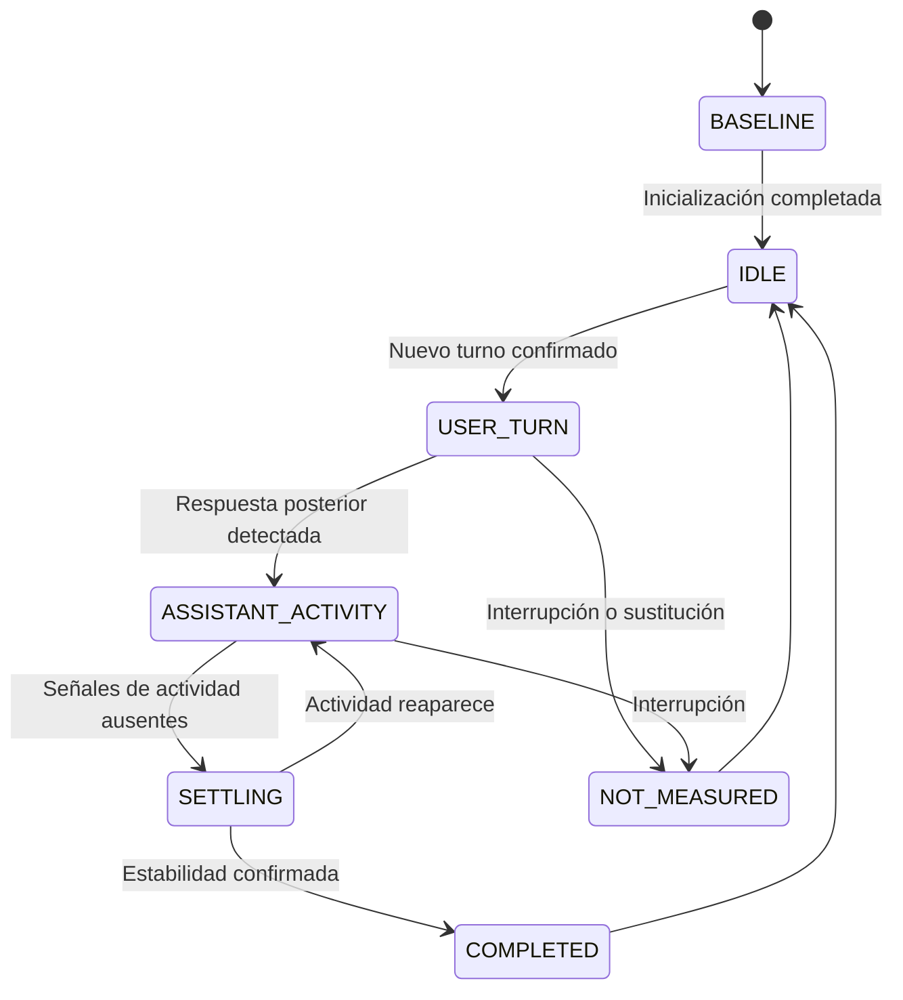

# Harmonia

**User:** Anonymous  
**Created:** 11/6/2026 17:13:55  
**Updated:** 11/8/2026 11:04:46  
**Exported:** 11/8/2026 11:05:33  
**Link:** [https://chatgpt.com/c/6aee5f33-5e54-83e8-898f-e7a26788c973](https://chatgpt.com/c/6aee5f33-5e54-83e8-898f-e7a26788c973)  

## Prompt:
6/11/2026, 5:15:48 p.m.

Documenta en  OCP frente de tabajo Harmonai ChatGPT-HARMONIA-20261106-1715 persistencia documental, via rdc

Retoma repsosnabilidad del frente, autorizacion previa.

## Response:
6/11/2026, 5:14:13 p.m. · gpt-6-t-mini-mini

Voy a verificar el estado del frente y el canal RDC, localizar el OCP documental correspondiente y comprobar el alcance de la autorización antes de escribir. La persistencia quedará diferenciada entre propuesta, ejecución y verificación; no asumiré folios ni evidencia que no pueda leer de vuelta.

El equipo RDC disponible es `PC10RCIF4EI4` \(Windows); la conexión está activa. El historial reciente muestra actividad de otro frente OCP y procesos aún abiertos, por lo que voy a aislar primero la evidencia de Harmonai y el destino documental exacto para no mezclar frentes ni alterar archivos ajenos.

El historial no acredita todavía un frente Harmonai: la actividad encontrada corresponde a `MCP-OCP-PPR-20261106`, así que no voy a imputarla al identificador solicitado. Estoy cotejando la metodología local disponible y buscando la raíz documental del frente por su identificador exacto antes de seleccionar el destino.

> **Enumeraste dispositivos y recuperaste contexto reciente**
>
> 
>
> **Buscando en la web**
>
> 
>
> **Revisé la configuración, llamadas recientes y sesiones activas**
>
> 
>
> **Ubicando el proyecto Harmonai**
>
> Estoy buscando la carpeta o documentación de Harmonai en el escritorio, sin quedarme atrapado por la diferencia entre las marcas de tiempo. Primero confirmaré la ubicación exacta y luego revisaré su estructura para continuar con la persistencia documental.
>
> **Ubicó el proyecto Harmonai**
>
> 
>
> **Verificaste documentos OCP autorizados y llamadas recientes**
>
> 
>
> **Revisando documentación local**
>
> Estoy aislando las secciones DUG y ARR del material disponible, además de confirmar dónde está registrado el frente Harmonai. Después, revisaré los índices y el estado documental para ubicar la ruta correcta sin asumirla.
>
> **Rastreando el frente Harmonai**
>
> Estoy confirmando si Harmonai vive como proyecto separado o dentro del repositorio documental. Revisaré sus archivos de orientación, el registro de frentes y la ruta metodológica para establecer el punto correcto de trabajo.
>
> **Verificando el OCP canónico**
>
> La documentación ubica Harmonai dentro del repositorio Khora, no solo en la carpeta local del proyecto. Estoy comprobando el control, el objeto canónico y las reglas de transferencia antes de modificar cualquier registro.
>
> **Verificado el OCP canónico**
>
> 
>
> **Localizaste y validaste documentación, repositorios, autorización y responsabilidad OCP**
>
> 
>
> **Inspeccionó metodología y documentos DUG y OCP locales**
>
> 
>
> **Revisado el control canónico y la gobernanza de Harmonia y DUG**
>
> 
>
> **Inspeccionaste archivos canónicos y estado documental de Harmonia y DUG**
>
> 
>
> **Revisó el control canónico y las responsabilidades de Harmonia y DUG**
>
> 
>
> **Determinando el siguiente paso**
>
> La transferencia está solicitada, pero el dispositivo disponible no coincide con el autorizado en el control vigente. Necesito confirmar autorización explícita para usar este equipo y actualizar el registro mediante el canal documental indicado.
>
> **Verificaste autorizaciones y documentación canónica antes de transferir vía RDC**
>
> 
>
> Procesó durante 3m 36s

**Retoma identificada; transferencia y persistencia bloqueadas por discrepancia de autorización RDC.** No se ha escrito ni alterado ningún documento.

### 1\. Frente y responsabilidad

Identifiqué el OCP canónico de **Harmonia**\:

- Repositorio: `SeryMente/khora`
- Ruta: `docs/frentes/harmonia/`
- Núcleo vigente: `OBJETO-CANONICO.md`
- Versión: **v0.43 · HARMONIA-v0.43**
- Estado documentado: §49, corte del 2 de noviembre de 2026.
- Titularidad del control: **generación 14**, asignada a otra instancia.

Control leído en `main`\: blob SHA `90e24321237000fea6b594c62fc3564445c82bc6`\.

### 2\. Autorización RDC: discrepancia que impide escribir

Hay dos identidades distintas\:

| Dato | Identidad |
|--------|--------|
| Dispositivo autorizado actualmente por el control Harmonia | `015RENTA01` · `aacf2eb5-17f4-428e-9242-c24a1fe4a2ec` |
| Dispositivo conectado en esta sesión | `PC10RCIF4EI4` · `d0bbb2a3-d7b4-45e1-8870-652c2c3844fc` |

La autorización vigente está ligada al UUID de `015RENTA01`, no al nombre visible de un equipo. Ese UUID no aparece entre los dispositivos conectados. **PC10RCIF4EI4 no tiene autorización vigente para operar sobre Harmonia.**

Precisión respecto de mi avance anterior: la referencia a PC-8 pertenece al antecedente de transferencia; la autorización posterior registrada en el control y en §1 del núcleo identifica a `015RENTA01` como dispositivo actual.

La instrucción que acabas de dar sí expresa la decisión de retomar la responsabilidad, pero no sustituye la autorización específica del dispositivo RDC.

### 3\. Persistencia documental prevista

El registro corresponde a\:

`ChatGPT-HARMONIA-20261106-1715`

Su destino es el OCP existente, preservando su estructura y procedencia. La captura debe distinguir el original conversacional, la crónica del ciclo y su evidencia. No se creará un OCP paralelo ni se usará `Desktop\Harmonia` como destino documental.

No hay todavía archivo persistido, SHA de contenido ni lectura de vuelta. Estado: **PENDIENTE**\.

### 4\. Gobierno consultado

- DUG: **v377 · NX-377m**\.
- Metacanon: **1.28**\.
- GOW: **2.17**\.
- DUG en `SeryMente/metodologia/main`, blob `54064c8fe00f872023a455f06596061ed69062ae`\.
- Núcleo Harmonia en `main`, blob `d1cf7981eafccf318f6c80bc8aa860a84175f7f4`\.
- Frescura exacta en días, horas y minutos: **NO VERIFICADA**\.
- FOL1: preparado, no activo. No corresponde asignar folios nuevos.

La sección de arranque aplicada al frente es §2, **LEER PRIMERO**, del núcleo Harmonia. No localicé un ancla independiente `§ARR` en el contenido humano del DUG consultado.

### 5\. Identificación conversacional

| Registro | Estado |
|--------|--------|
| IPZ | v0.7 · antigüedad NO VERIFICADA |
| CONV global / OCP | PENDIENTE / NO ASIGNADO |
| CICLO global / OCP | PENDIENTE / NO ASIGNADO |
| A global / OCP | PENDIENTE / NO ASIGNADO |
| B global / OCP | PENDIENTE / NO ASIGNADO |
| Identificador nativo de conversación | NO EXPUESTO |
| UUIDv7 local de esta retoma | NO ASIGNADO |

---

**Una autorización concreta para desbloquear la operación\:**

¿Autorizas expresamente que `PC10RCIF4EI4`, UUID `d0bbb2a3-d7b4-45e1-8870-652c2c3844fc`, sustituya a `015RENTA01`, UUID `aacf2eb5-17f4-428e-9242-c24a1fe4a2ec`, como dispositivo RDC autorizado exclusivamente para esta retoma y persistencia documental de Harmonia?

Con esa autorización podré efectuar la transferencia condicionada del control y la persistencia con cotejo SHA y lectura de vuelta.

## Prompt:
6/11/2026, 5:20:34 p.m.

`PC10RCIF4EI4` · `d0bbb2a3-d7b4-45e1-8870-652c2c3844fc` &#x20;
Este es el que has de usar,  a no ser qu eno este disponible usas otro y ya.&#x20;

Que cotntienen  tus tareas provisionales,en  pocas  palabtras,quiero saber dponde estamos

## Response:
6/11/2026, 5:19:09 p.m. · gpt-6-t-mini-mini

Tomo `PC10RCIF4EI4` como tu dispositivo preferido para RDC; si no está disponible, buscaré otro sin detenerme por el nombre visible. Para responder dónde estamos, voy a consultar el índice vigente de las tareas provisionales de Gobernanza, sin confundirlas con tareas técnicas propias de Harmonia.

> **Revisando la ruta**
>
> Estoy ubicando el archivo `README.md` dentro del repositorio de Metodología y verificando la lista de tareas provisionales. También estoy considerando que PC10 es el equipo autorizado para continuar, sin modificar nada todavía.
>
> **Aclarando la autorización**
>
> Estoy interpretando que PC10 es el equipo predeterminado y que puedo usar otro si no está disponible. Antes de asumir formalmente el frente, necesito confirmar si también autorizas transferir la responsabilidad al hilo actual.
>
> **Revisé la ruta y aclaré la autorización**
>
> 
>
> **Ubicando el avance**
>
> Estoy en la fase de ordenar 14 tareas provisionales de Gobernanza: 10 pendientes, 3 en progreso y 1 en revisión. La prioridad actual es cerrar criterios, evidencias y responsables antes de ejecutar cambios.
>
> **Confirmando el equipo**
>
> Estoy tomando PC10 como equipo principal y usaré otro solo si no está disponible. El panorama sigue igual: 14 tareas provisionales, con 10 pendientes, 3 en progreso y 1 en revisión.
>
> **Ubicado el avance y confirmado el equipo**
>
> 
>
> **Resumiendo el estado**
>
> Las tareas son del registro provisional de Gobernanza, no asignaciones personales: hay 14 en total, 10 en curso, 3 pendientes y 1 cancelada. El frente sigue **en curso, no aceptado**; faltan validaciones IPZ, admisión, MDP, Sync/Sink, MCP y restauración.
>
> **Aclarando la responsabilidad**
>
> Las 14 tareas provisionales siguen en curso, pero este hilo aún no figura como responsable formal de Harmonia. PC10 queda como equipo principal; falta confirmar si autorizas transferirle la responsabilidad del frente.
>
> **Resumido el estado y aclarada la responsabilidad**
>
> 
>
> **Calculado el estado OCP y buscados commits de gobernanza**
>
> 
>
> Procesó durante 40s

Entendido. **PC10RCIF4EI4 será mi terminal RDC preferente** $`d0bbb2a3-d7b4-45e1-8870-652c2c3844fc`$. Si no está disponible, utilizaré otra terminal disponible, sin asumir que tiene los mismos permisos. PC10 aparecía ONLINE en la última consulta.

## Dónde estamos

He identificado que las tareas provisionales consultadas pertenecen al OCP de Gobernanza, no son un backlog independiente de Harmonia.

# 10

En curso

# 3

Pendientes

# 1

Cancelada

**Las 14 tareas, agrupadas por propósito\:**

| Área | Qué estamos haciendo |
|--------|--------|
| Gobernanza | Validar los 43 principios y reconciliar documentación. |
| Acceso | Terminar IPZ, admisión obligatoria y foliación FOL1. |
| Consulta normativa | Conseguir consulta individual verificable de principios mediante OCP MCP. |
| Coordinación | Mantener comunicación y verificación entre Gobernanza, EP y MCP-OCP. |
| Rendimiento | Medir tiempos y reducir fricción. |
| Persistencia | Integrar respaldos locales, Backblaze y restauración entre equipos. |
| Tareas diferidas | Resolver referencias incompletas y decidir el ámbito Tareas. |

## Estado general del sprint

(EN CURSO · NO ACEPTADO)

Los bloqueos principales son\:

1. IPZ todavía sin instalación nativa verificada.
2. Admisión fail-closed sin prueba integral.
3. Consulta individual de principios sin aceptación E2E.
4. Conflicto terminológico Sync/Sink pendiente de resolución.
5. Persistencia remota y restauración entre equipos no verificadas.

La coordinación trilateral sigue en curso. No existe todavía aceptación global ni porcentaje de avance aprobado.

**Fuente\:** [github.com](https://github.com/SeryMente/metodologia/blob/main/frentes/gobernanza/%F0%9F%93%81%20%F0%9F%A7%AD%20-%20Tareas%20provisionales/README.md?utm_source=chatgpt.com)\.

## Mi situación respecto de Harmonia

El OCP está identificado y su versión vigente es **v0.43**\. Sin embargo, el control autoritativo sigue registrando generación 14 y otro titular. Tu indicación resuelve la preferencia de terminal, pero todavía no he actualizado la titularidad.

**Una última confirmación\:** ¿autorizas que esta conversación sustituya al titular actual de Harmonia, pasando a generación 15 mediante transferencia de responsabilidad?

---

**Identificación documental**

- IPZ: v0.7 · antigüedad NO VERIFICADA.
- DUG: v377 · NX-377m · Metacanon 1.28 · GOW 2.17.
- CONV / CICLO / A / B: folios globales y OCP PENDIENTES / NO ASIGNADOS.
- FOL1: PREPARADO, NO ACTIVO.
- Persistencia de esta conversación: PENDIENTE.

No se ha escrito aún el nuevo original documental.

## Prompt:
7/11/2026, 10:15:14 a.m.

Si

## Response:
7/11/2026, 10:13:39 a.m. · gpt-6-t-mini-mini

Autorización de transferencia recibida. Antes de modificar el OCP comprobaré de nuevo el control canónico, la disponibilidad e identidad de PC10 y el estado de la ruta; después registraré la transferencia de titularidad con historial preservado y verificaré el resultado mediante lectura posterior.

PC10 está disponible y su identidad ya quedó verificada: Windows 11 Pro, equipo `PC10RCIF4EI4`, usuario `CENTRAL\MantenimientoRCI`, perfil `C:\Users\MantenimientoRCI`\. El control publicado sigue en generación 14 y aún atribuye la titularidad a otra instancia; por tanto, no haré una escritura directa sobre el clon antiguo. Prepararé una copia limpia y aplicaré la actualización con control de concurrencia y lectura de vuelta.

La ruta de trabajo limpia está inicializada en la terminal autorizada. El clon filtrado todavía descarga la rama; la mutación permanece bloqueada hasta que el `HEAD`, el SHA del control y el árbol de trabajo coincidan exactamente con la revisión observada.

> **Verificando dispositivos, controles y datos DUG**
>
> 
>
> **Verificados dispositivos, controles y archivos canónicos de gobernanza**
>
> 
>
> **Preparando verificación remota**
>
> Estoy priorizando la verificación de la configuración, la identidad del equipo y el alcance de rutas permitidas. También estoy revisando la discrepancia entre el dispositivo autorizado previamente y PC10 antes de actualizar cualquier registro.
>
> **Preparó la verificación remota**
>
> 
>
> **Verificando transferencia**
>
> Estoy validando la identidad del equipo, la versión operativa y los archivos locales antes de actualizar el registro. También estoy comprobando que el cambio a PC10 quede documentado sin modificar rutas fuera del alcance autorizado.
>
> **Verificó dispositivos, controles, identidad y metadatos de PC10 y DUG**
>
> 
>
> **Simplificó la extracción de títulos HTML**
>
> 
>
> **Extraje el título HTML mediante métodos de cadena**
>
> 
>
> **Generaste UUIDv7 usando Math.random**
>
> 
>
> **Actualizando control**
>
> Estoy preservando el historial completo mientras registro la transferencia a PC10. La versión operativa y la identidad local se mantienen sin cambios; solo estoy ajustando el dispositivo autorizado y dejando trazabilidad del relevo.
>
> **Consolidando el relevo**
>
> Estoy registrando la nueva generación con PC10 como dispositivo autorizado, conservando el propietario anterior, la revisión base y el historial de transferencias. También estoy dejando constancia de que el alcance se limita a esta continuidad operativa.
>
> **Actualizó el control y consolidó el relevo**
>
> 
>
> **Registrando transferencia**
>
> Estoy preparando una actualización de generación que conserva el historial, mantiene el folio sin asignar y limita PC10 a esta continuidad operativa. También estoy usando una comparación previa para evitar sobrescribir cambios concurrentes.
>
> **Registraste una transferencia**
>
> 
>
> **Actualicé el control de responsabilidad con principios DUG, ARR y CAS**
>
> 
>
> **Verificado el proceso y monitoreada la clonación Git**
>
> 
>
> **Revisando alcance operativo**
>
> Estoy detectando una restricción histórica sobre usar cierto perfil como raíz operativa. La nueva autorización del equipo parece supersederla, pero voy a limitar el trabajo al repositorio y confirmar el alcance antes de continuar.
>
> **Revisado el alcance operativo**
>
> 
>
> **Verificó el proceso Git, repositorio, README y manifiesto correcto**
>
> 
>
> **Ajustando el entorno**
>
> Detecté que el perfil activo no coincide con la ruta histórica registrada. Estoy deteniendo el uso de ese perfil como raíz y continuaré únicamente desde una ubicación temporal externa, preservando la trazabilidad y evitando tocar archivos personales.
>
> **Confirmando el alcance**
>
> Estoy verificando que PC10 coincida con la autorización actual y que el trabajo permanezca limitado al repositorio operativo. La ruta histórica solicitada no aparece en el perfil activo, así que evitaré asumir que está disponible.
>
> **Documentando el relevo**
>
> Estoy registrando la transferencia a PC10 y dejando el archivo solicitado como pendiente: no aparece en el perfil activo. Mantengo el folio sin asignar y limitaré los cambios al repositorio operativo autorizado.
>
> **Ajustado el entorno, confirmado el alcance y documentado el relevo**
>
> 
>
> **Verificando transferencia segura**
>
> Estoy confirmando que PC10 corresponde a la autorización actual y que el trabajo se mantiene dentro del repositorio operativo. El archivo solicitado no aparece en el perfil activo, así que no asumiré que está disponible.
>
> **Preparando la transferencia**
>
> Estoy verificando la autorización explícita, el dispositivo exacto y el estado documental antes de actualizar la responsabilidad. Mantendré el historial previo, dejaré el folio pendiente y señalaré que el archivo original aún no aparece.
>
> **Verificó y preparó la transferencia segura**
>
> 
>
> **Leí el manifiesto y consulté resultados de búsqueda adicionales**
>
> 
>
> **Editado el control mediante un clon local y ejecutada nueva llamada**
>
> 
>
> **Ejecutaste el proceso solicitado**
>
> 
>
> **Procesaste una tarea relacionada con fechas estables**
>
> 
>
> **Ejecutado proceso en terminal**
>
> 
>
> **Iniciaste proceso autorizado y consultaste resultados adicionales**
>
> 
>
> **Verificaste responsabilidades, estado de HEAD y metadatos documentales**
>
> 
>
> **Documenté transferencia, actualicé núcleo, manifiesto y auditoría**
>
> 
>
> **Inicié el proceso en terminal y consulté su salida**
>
> 
>
> **Corregida la llamada y leídos los resultados del sondeo**
>
> 
>
> **Validaste manifiestos, corregiste validaciones y verificaste documentación final**
>
> 
>
> **Verificaste y publicaste cambios seleccionados sin hacer push**
>
> 
>
> **Verificaste la creación y envío del commit y consultaste el proceso**
>
> 
>
> **Verificaste documentos, hashes, manifiestos y procedencia en GitHub**
>
> 
>
> **Ejecutaste un script y verificaste su proceso y salida**
>
> 
>
> **Verificaste manifiesto, commits y estado limpio del repositorio**
>
> 
>
> **Verificó el estado final de RDC y el progreso del proceso**
>
> 
>
> Procesó durante 14m 53s

(Transferencia ejecutada y verificada)

La responsabilidad de **Harmonia** quedó transferida de la generación 14 a la **generación 15**\. La actualización se hizo mediante RDC en `PC10RCIF4EI4`, con el UUID exacto que autorizaste.

### 1\. Titularidad y control

| Campo | Resultado |
|--------|--------|
| Generación | 15 |
| Alias operativo | `chatgpt-harmonia-01a1b6ca-4543-7578-85d9-7624877c2e80` |
| UUIDv7 local | `01a1b6ca-4543-7578-85d9-7624877c2e80` |
| Terminal RDC | `PC10RCIF4EI4` |
| UUID RDC | `d0bbb2a3-d7b4-45e1-8870-652c2c3844fc` |
| Titular anterior | Preservado en generación 14 y en el historial |
| ID nativo de conversación | No expuesto por la plataforma |
| Folio de sesión | No asignado; FOL1 continúa inactiva |

El control se publicó mediante el commit `6f330f2301f2f2b55988ecbb5285c2b3a45621b7`\. Su lectura de vuelta en `main` confirmó generación 15 y el SHA del control `0e090e1f3537b75891344af812e576e39a5f5e02`\.

### 2\. Persistencia documental

(PERSISTIDO Y VERIFICADO)

El OCP quedó actualizado a **v0.44 / HARMONIA-v0.44**, conservando su ruta histórica `docs/frentes/harmonia/`\.

Se publicaron y cotejaron\:

- [github.com](https://github.com/SeryMente/khora/blob/main/docs/frentes/harmonia/OBJETO-CANONICO.md?utm_source=chatgpt.com)\.
- [github.com](https://github.com/SeryMente/khora/blob/main/docs/frentes/harmonia/CONTROL-RESPONSABILIDAD.json?utm_source=chatgpt.com)\.
- [github.com](https://github.com/SeryMente/khora/blob/main/docs/frentes/harmonia/cronica/HARMONIA-TRANSFER-G15-20261107.md?utm_source=chatgpt.com)\.
- [github.com](https://github.com/SeryMente/khora/blob/main/docs/frentes/harmonia/evidencias/EV-HARMONIA-TRANSFER-G15-20261107.json?utm_source=chatgpt.com)\.
- [github.com](https://github.com/SeryMente/khora/blob/main/docs/frentes/harmonia/documentos/MANIFIESTO-DOCUMENTAL.json?utm_source=chatgpt.com)\.
- Procedencia y README actualizados.

Commits documentales\:

- `b82459a0e4b89edc0ade8f060577b300a7a3b194`
- `694a7ffbf62893604c0a80bfcf0460af2475a5d3`

La última lectura confirmó que `HEAD` y `origin/main` coinciden en `694a7ffb…` y que el árbol de trabajo RDC está limpio.

### 3\. Archivo solicitado: pendiente

(NO CAPTURADO)

El archivo `ChatGPT-HARMONIA-20261106-1715` no apareció en el inventario de originales del OCP ni en las búsquedas exactas de `Downloads` y `Desktop` del perfil verificado. La búsqueda del perfil completo también dio cero coincidencias, pero RDC notificó directorios inaccesibles.

Por integridad documental, no fabriqué el export ni sustituí el original por el anterior `ChatGPT-HARMONIA-20261101-1709.md`\. El manifiesto registra el archivo solicitado como `NO_CAPTURADO / NO_LOCALIZADO_EN_RUTAS_CONSULTADAS`\.

**Siguiente requisito\:** proporcionar el archivo original o una ruta accesible en PC10. Entonces se podrá preservar sin transformación, calcular su SHA-256, incorporarlo a `originales/` y verificar su lectura de vuelta.

La transferencia no modificó el código de producto: PR \#353 continúa en borrador y sin merge; Chrome y el transporte EP remoto siguen pendientes.

---

### Identificación metodológica

- **IPZ\:** v0.7 · edad `NO VERIFICADA`; instalación nativa `NO VERIFICADA`\.
- **DUG\:** v377 · NX-377m · edad `NO VERIFICADA`\.
- **OCP Harmonia\:** v0.44 · `0.0.0` al último cotejo de `main` \(19 segundos).
- **CONV\:** folio global y OCP `PENDIENTES / NO ASIGNADOS`\.
- **CICLO 1\:** folios global y OCP `PENDIENTES / NO ASIGNADOS`\.
- **A/B\:** folios `PENDIENTES / NO ASIGNADOS`\.
- **FOL1\:** `PREPARADA_PENDIENTE_ACTIVACION`\.
- **MCP normativo\:** `DESACTIVADO`\.

La titularidad quedó transferida y la documentación de la transferencia está verificada. El único bloqueo documental de la solicitud original es disponer de los bytes del export del 6 de noviembre.

## Prompt:
8/11/2026, 10:33:47 a.m.

Que opinas de este encargo?

# ENCARGO DE CONSTRUCCIÓN — TELEMETRÍA DE CICLOS CONVERSACIONALES EN HARMONIA

## 1. Objetivo

Ampliar la extensión existente **Harmonia**, perteneciente al repositorio `SeryMente/khora`, para que además de observar la estructura de la interfaz de ChatGPT pueda medir, en tiempo real, la duración observable de los ciclos conversacionales.

La ampliación debe integrarse en el producto existente. No construyas una segunda extensión, no reconstruyas Harmonia y no dupliques funcionalidades que ya estén implementadas.

**Objetivo funcional único:**

Obtener una medición local, correlacionable y verificable de la duración entre el momento en que un nuevo turno del usuario aparece en la interfaz y el momento en que la respuesta correspondiente del asistente queda visiblemente terminada.

La medición representa tiempo observado en el cliente. No representa tiempo interno de procesamiento de OpenAI ni latencia del servidor.

El criterio rector de este encargo es: **NO MÁS, PERO TAMPOCO MENOS.**

## 2. Adquisición obligatoria antes de modificar código

Antes de escribir:

1. Lee el gobierno vigente, Metacanon y el DUG aplicable.
2. Lee íntegramente:
   - `docs/frentes/harmonia/OBJETO-CANONICO.md`
   - `docs/frentes/harmonia/README.md`
   - `docs/frentes/harmonia/prompts/CONSTRUCTOR.md`
3. Inspecciona, solo en lectura, el control de responsabilidad de Harmonia. No lo modifiques ni asumas titularidad.
4. Inspecciona el estado actual de `main` y vuelve a leer los archivos fuente y sus SHA.
5. Revisa los tests existentes y el contrato efectivo entre la extensión, el service worker y el colector.
6. Examina la PR #353 y su rama candidata de persistencia local-first. Revalida su estado actual, base, head, diferencias y compatibilidad con `main`. No asumas que su descripción histórica sigue siendo vigente.

Fuentes técnicas iniciales de referencia:

- OCP Harmonia: `docs/frentes/harmonia/OBJETO-CANONICO.md`.
- Extensión existente: `apps/harmonia-observability/extension/`.
- Colector: `apps/harmonia-observability/collector/server.js`.
- Consulta: `apps/harmonia-observability/collector/query.ps1`.
- Persistencia candidata: PR #353, sin presuponer que esté integrada.

La extensión correcta que se debe ampliar es `apps/harmonia-observability/extension/`.

No confundas este componente con la sombrilla modular `khora-web/extension/harmonia/` (Aisthesis/Halcón). No renombres ni alteres esa sombrilla.

## 3. Estado funcional que debes conservar

Harmonia ya dispone de observación estructural de la interfaz de ChatGPT, incluyendo:

- Región principal y estructura DOM.
- Roles y atributos estructurales de elementos.
- Metadatos limitados de controles.
- Presencia del compositor y controles conocidos.
- Rasgos estructurales de respuestas.
- Indicadores conocidos de generación.
- Observación de mutaciones.
- Huellas SHA-256 de superficies.
- Gestión de pestañas y sesiones.
- Envío de eventos al colector local.
- Persistencia JSONL e índice local.

No reconstruyas estas funciones ni modifiques su comportamiento sin necesidad demostrada.

El barrido estructural actual tiene debounce y limitación de frecuencia. **No debe utilizarse como cronómetro del ciclo ni acelerarse globalmente.**

La nueva capacidad debe tener un observador estrecho, basado en transiciones relevantes, separado del escaneo estructural general.

## 4. Contrato de medición

La única magnitud primaria es:

`duration_ms`

Representa la duración del ciclo conversacional observable en el cliente.

No añadas otras métricas de rendimiento.

### 4.1 Inicio

Emite el evento:

`client.cycle.started`

El inicio se produce cuando el observador confirma que un nuevo turno del usuario ha aparecido en la región principal de conversación de ChatGPT.

Condiciones:

- Al inicializarse, el observador establece una línea base de los mensajes ya presentes.
- El historial preexistente no debe generar ciclos falsos.
- Un nuevo turno debe distinguirse de una reconstrucción o sustitución del DOM.
- La detección debe basarse en roles, atributos estructurales, identidad de nodos y posición cronológica.
- Un clic en Enviar, una pulsación de tecla o una mutación genérica no constituyen por sí solos confirmación de envío.
- No leas el texto del mensaje ni el contenido del compositor.
- Un mismo turno no debe producir varios eventos de inicio.

El instante de inicio es el momento de la primera observación verificable del nuevo turno representado en la interfaz.

### 4.2 Final

Emite:

`client.cycle.completed`

El final solo se produce cuando se cumplen conjuntamente estas condiciones:

1. Existe un turno del asistente posterior al inicio del ciclo.
2. No quedan señales visibles conocidas de generación o actividad.
3. No se detecta actividad visible pendiente de herramientas o agentes.
4. La zona relevante de respuesta permanece estable durante una ventana de asentamiento.

Debes revisar y validar las señales existentes en Harmonia, incluyendo las que actualmente detectan:

- `aria-busy`
- `data-is-streaming`
- Controles de detener generación.
- Indicadores de progreso de agentes o tareas.
- Estado del compositor cuando sea un indicador estructural fiable.

No supongas que la ausencia de una sola señal demuestra que la respuesta terminó.

La ventana inicial candidata de asentamiento es `1500 ms`.

Debe mantenerse como constante documentada y validarse mediante pruebas. Si las pruebas muestran finalización prematura durante ciclos con herramientas, ajusta la señal o la ventana con evidencia. No introduzcas esperas artificiales en la interacción de ChatGPT.

**Importante:** el timestamp de finalización será el instante de la última transición relevante que deja la interfaz inactiva y estable. La ventana de asentamiento confirma la estabilidad; no se añade artificialmente a `duration_ms`.

### 4.3 Ciclos incompletos

Un ciclo que tenga inicio, pero no final verificable, debe identificarse como:

`NOT_MEASURED`

No calcules duración parcial como si fuera una medición completa.

La consulta debe poder reconocer inicios sin final y presentar la razón cuando pueda demostrarse, por ejemplo:

- Cierre de pestaña.
- Navegación.
- Reinicio del observador.
- Nuevo turno que sustituye un ciclo anterior.
- Ausencia de una señal final fiable.

No inventes la causa cuando solo se conoce que falta el evento de finalización.

La primera versión mide nuevos turnos de usuario representados como nodos nuevos. Regeneraciones, ediciones y reenvíos de mensajes existentes, reintentos sin nuevo turno visible y modos de voz no validados quedan fuera de la cobertura medida. No los conviertas en ciclos nuevos mediante inferencias.

## 5. Reloj e identidad

Los dos extremos deben medirse en la misma instancia de documento mediante:

`performance.now()`

Reglas:

- Calcular `duration_ms` mediante diferencia monotónica.
- Registrar marcas UTC para auditoría.
- Registrar fuente del reloj y precisión disponible.
- No calcular duración restando timestamps de pared.
- No calcular la duración en el colector a partir de marcas UTC.

Introduce dos identificadores locales:

- `conversation_id`: UUIDv7 local del contexto conversacional observado.
- `cycle_id`: UUIDv7 local del ciclo.

No utilices como identificadores los IDs nativos de ChatGPT.

No persistas rutas completas, IDs nativos de conversaciones, parámetros privados de URL o datos de cuenta.

Los identificadores existentes `eventId` y `sessionId` deben mantener compatibilidad con Harmonia. Los identificadores nuevos deben cumplir UUIDv7 y tener pruebas específicas de versión, variante y unicidad.

Los eventos de inicio y final deben compartir exactamente el mismo `conversation_id` y `cycle_id`.

No generes folios FOL1 ni inventes identificadores de conversación, ciclo u OCP.

## 6. Contrato de eventos y colector

Añade soporte explícito para:

- `client.cycle.started`
- `client.cycle.completed`

Respeta el recorrido existente:

`content script → service worker → colector local → JSONL`

El service worker debe validar y enrutar los nuevos eventos.

El colector debe:

1. Incorporar ambos tipos a una allowlist explícita.
2. Validar sus identidades y campos.
3. Aplicar saneamiento específico para cada tipo.
4. Rechazar propiedades no autorizadas.
5. Conservar las marcas temporales, identidades y duración necesarias.
6. Mantener la idempotencia y el control de eventos duplicados.
7. Escribir los eventos en el almacén JSONL local existente.

No basta con ampliar la expresión regular que permite tipos de eventos. Debes revisar el saneamiento efectivo: actualmente los eventos que no pertenecen a las ramas conocidas pueden reducir su payload a un motivo genérico. La telemetría nueva necesita una rama explícita y estricta.

El payload permitido debe limitarse a:

- `conversation_id`
- `cycle_id`
- Identidad de sesión y evento ya existente.
- Tipo y fase del evento.
- Timestamp UTC de inicio o final.
- Marca monotónica correspondiente.
- `duration_ms`, solo en el evento de finalización.
- Fuente y precisión del reloj.
- Metadatos mínimos de cobertura necesarios para interpretar el registro.

No almacenes payloads de mensajes, contenido del compositor ni información de herramientas.

## 7. Persistencia local y PR #353

Reutiliza el colector y el almacén local de Harmonia.

La persistencia nunca debe bloquear ni retrasar la interacción de ChatGPT.

Examina la PR #353 para evaluar su propuesta de outbox IndexedDB y persistencia local-first.

- No asumas que la rama sigue siendo compatible con `main`.
- No fusiones la PR.
- No arrastres indiscriminadamente su contenido.
- No crees una segunda outbox, una cola paralela ni otro mecanismo de reintentos.
- Reutiliza piezas únicamente si la inspección demuestra que son compatibles y necesarias para esta ampliación.
- Si no es seguro reutilizarlas dentro del alcance, conserva el transporte actual y documenta con exactitud su límite de durabilidad.

No implementes persistencia remota en este encargo.

Quedan expresamente excluidos:

- Responses API.
- Exportaciones del historial.
- Neon/PostgreSQL.
- Cloudflare Queues.
- B2.
- Servicios o bases de datos nuevos.
- Endpoints remotos.
- Clientes MCP nuevos.
- Escrituras en el OCP central.

## 8. Consulta mínima de ciclos

El script existente `collector/query.ps1` ya dispone de filtros por tipo de evento.

Añade, si resulta necesario tras revisar el contrato real, una opción sencilla `-Cycles` para:

- Agrupar los eventos por `conversation_id` y `cycle_id`.
- Emparejar inicio y final.
- Mostrar `duration_ms` para ciclos completos.
- Marcar inicios sin final como `NOT_MEASURED`.
- Exponer la razón solo cuando exista evidencia.

No construyas un dashboard, panel o interfaz adicional.

No rediseñes el popup de Harmonia.

La consulta es una herramienta mínima de recuperación y lectura de la única magnitud aprobada.

## 9. Privacidad y seguridad

No debilites las protecciones existentes.

Está prohibido capturar, persistir o transmitir:

- Texto de mensajes del usuario.
- Texto de respuestas del asistente.
- Borradores del compositor.
- Valores de campos.
- `textContent`, `innerText`, `innerHTML`, `outerHTML`.
- HTML bruto.
- Contenido conversacional de atributos.
- Cookies, tokens o credenciales.
- Cuerpos de solicitudes HTTP o mensajes WebSocket.
- URLs completas o IDs nativos de conversación.

No añadas:

- Permiso `debugger`.
- Interceptación de red.
- Endpoints privados.
- Scripts remotos.
- Permisos de host adicionales.
- Acceso a otros sitios o pestañas.

El observador podrá utilizar `MutationObserver` sobre cambios estructurales, atributos de estado y mutaciones `characterData` únicamente para registrar el instante de una mutación.

Cuando utilices `characterData`, no leas ni conserves el valor del nodo, su contenido anterior o posterior. La observación debe ser exclusivamente temporal.

Incluye pruebas que demuestren que esta frontera de privacidad se mantiene.

No añadas clasificación semántica del ciclo. La taxonomía de categorías permanece pendiente de aprobación.

## 10. Pruebas obligatorias

Añade pruebas automatizadas reproducibles para:

### Detección de inicio

- La línea base no produce ciclos.
- Un turno nuevo produce exactamente un inicio.
- La reconstrucción del DOM no genera inicios falsos.
- Los turnos históricos no se convierten en ciclos nuevos.

### Detección de final

- Una respuesta parcial no se considera final.
- Varias mutaciones no producen eventos duplicados.
- Una señal busy activa impide finalizar.
- La aparición o reaparición de señales de actividad reinicia la ventana de estabilidad.
- El progreso de herramientas/agentes impide terminar prematuramente.
- La ausencia de actividad y la estabilidad permiten finalizar solo cuando existe un turno de asistente posterior al inicio.

### Duración e identidad

- Ambos eventos comparten identidad.
- El generador UUIDv7 cumple el contrato.
- La duración se calcula con reloj monotónico.
- La ventana de asentamiento no se suma artificialmente a la duración.
- No se producen duraciones negativas ni emparejamientos entre ciclos diferentes.

### Interrupciones

- Segundo envío antes del final.
- Cierre de pestaña.
- Navegación.
- Reinicio del observador.
- Regeneración.
- Edición/reenvío.
- Ausencia de señal final.

Los casos no verificables deben quedar sin medición, no recibir una duración inventada.

### Colector y persistencia

- Los dos tipos de evento son aceptados.
- Los campos no autorizados son rechazados.
- Los duplicados son idempotentes.
- El JSONL conserva los campos necesarios.
- La lectura de vuelta recupera los mismos valores.
- La consulta empareja correctamente ciclos completos e incompletos.

### Privacidad y regresión

- No se captura texto ni valores del compositor.
- Las mutaciones `characterData` no causan lectura de contenido.
- No se persisten rutas ni identificadores nativos.
- Las funciones anteriores de Harmonia siguen operando.
- La suite relevante existente continúa pasando.

Las pruebas con fixtures sintéticas deben identificarse como tales. No las presentes como observación natural de ChatGPT.

## 11. Alcance de ejecución y autoridad

Trabaja sobre una rama nueva basada en el `main` vigente.

No uses Remote Desktop Commander. No instales ni cargues la extensión en Chrome. No operes el equipo del usuario ni su sesión autenticada.

No modifiques:

- `docs/frentes/harmonia/OBJETO-CANONICO.md`
- `docs/frentes/harmonia/CONTROL-RESPONSABILIDAD.json`
- El DUG o sus artefactos.
- El esquema central A/B de Gestión conversacional.
- El registro maestro de foliación.
- FOL1.
- OCP de otros frentes.

No modifiques la titularidad de Harmonia ni declares aceptación del producto.

No hagas merge a `main` ni fusiones PR.

Si descubres una incompatibilidad de gobierno, un conflicto de titularidad o una dependencia que requiere autorización ajena, detente en esa frontera y documenta el bloqueo. No lo resuelvas por inferencia.

## 12. Entregables

Al terminar, presenta:

1. Diagnóstico breve del estado de `main` antes de modificarlo.
2. Diagnóstico de PR #353 y decisión razonada sobre si se reutilizó alguna pieza.
3. Diseño de señales implementado y explicación de sus límites.
4. Archivos modificados y diff completo.
5. Tests ejecutados, comandos reales y resultados.
6. Escenarios soportados y no soportados.
7. Evidencia de privacidad y regresión.
8. Limitaciones de persistencia.
9. Instrucciones concretas para la posterior prueba natural autorizada en Chrome.
10. SHA de los artefactos y del commit de la rama, junto con lectura de vuelta verificada.

Distingue siempre entre propuesto, implementado, probado, verificado y aceptado.

La construcción termina cuando el cambio está limitado, probado automáticamente, publicado en una rama revisable y documentado. La aceptación natural en Chrome continúa pendiente hasta que el responsable autorizado la ejecute y verifique.

## 13. Criterio final

Harmonia debe continuar haciendo lo que ya hace.

La única capacidad adicional de este encargo es medir la duración observable del ciclo conversacional, con identidad, secuencia, reloj monotónico, persistencia local y privacidad.

No agregues funciones por conveniencia, anticipación o preferencia técnica.

No elimines controles existentes para simplificar.

**Construye exactamente esa capacidad adicional: ni una más, ni una menos.**

## Response:
8/11/2026, 10:33:55 a.m. · gpt-6-mini

> **Evaluando la propuesta**
>
> Estoy viendo una base sólida y bastante implementable. Detecto tres puntos que conviene cerrar antes: identidad DOM ante reemplazos, ciclos sin cierre y la diferencia entre registrar una transición y confirmar estabilidad.
>
> **Evaluaste la propuesta**
>
> 
>
> ****
>
> 
>
> Procesó durante 10s

Mi valoración: **es un encargo técnicamente sólido, bien delimitado y considerablemente más maduro que una especificación funcional convencional.** Tiene una virtud importante: no pide simplemente medir cuánto tarda ChatGPT, sino construir una medición reproducible de lo que realmente puede observarse desde el cliente, sin confundirlo con latencia interna del servidor.

Lo considero apto para pasar a una fase de inspección técnica. No recomendaría comenzar a modificar código sin resolver algunos puntos de precisión.

## 1\. Lo que está especialmente bien resuelto

### A. Delimitación del objetivo

La magnitud única `duration_ms` es una decisión correcta.

Evita que el proyecto derive hacia\:

- Analítica de productividad.
- Métricas de rendimiento del servidor.
- Clasificación semántica de conversaciones.
- Dashboards y funcionalidades no solicitadas.

La separación entre observación estructural y observación temporal también es fundamental. Acelerar el barrido DOM existente para conseguir mayor precisión sería un error arquitectónico.

### B. Calidad del contrato temporal

La combinación de\:

- `performance.now()`\.
- Marcas UTC para auditoría.
- Ventana de asentamiento.
- Detección de actividad visible.
- Confirmación de una respuesta posterior al inicio.

es conceptualmente correcta.

Especialmente acertada es esta distinción\:

> La ventana de asentamiento confirma la estabilidad; no se añade artificialmente a duration\_ms.

Evita introducir un sesgo sistemático en la medición.

### C. Privacidad

La prohibición de leer contenido conversacional, incluso cuando se observan mutaciones `characterData`, es importante.

La telemetría debe conocer que algo cambió, cuándo cambió y qué transición estructural ocurrió; no necesita conocer qué escribió el usuario o qué respondió el asistente.

### D. Gobernanza y ejecución

Me parece particularmente acertado que el encargo\:

- Exija inspeccionar el control sin modificarlo.
- Prohíba asumir titularidad.
- Excluya RDC.
- Exija una rama nueva basada en `main`\.
- Prohíba modificar el OCP central.
- Distinga implementación, prueba, verificación y aceptación.

Esto permite evaluar el producto sin mezclar construcción técnica con transferencia de responsabilidad o aceptación operativa.

---

## 2\. Los cinco puntos que resolvería antes de construir

No considero que invaliden el encargo. Son precisiones necesarias para evitar interpretaciones distintas entre agentes de implementación.

| Punto | Riesgo | Mi recomendación |
|--------|--------|--------|
| Identidad de turnos | Una reconstrucción del DOM puede parecer un turno nuevo. | Definir una estrategia explícita de identidad estructural y reconciliación. |
| Segundo envío | Puede existir un ciclo abierto cuando aparece otro turno. | Cerrar el anterior como `NOT_MEASURED` y comenzar uno nuevo, sin inventar su duración. |
| Finalización | La ausencia de `aria-busy` no demuestra que terminó la respuesta. | Exigir un conjunto de señales positivas y negativas, con pruebas de falsos positivos. |
| Interrupciones | Una pestaña puede cerrarse sin que el colector reciba un evento terminal. | Diferenciar causa demostrada de causa desconocida. |
| Persistencia | Un inicio puede guardarse y el final perderse. | Definir recuperación de ciclos incompletos mediante los registros efectivamente persistidos. |

Hay además una precisión especialmente importante.

### El timestamp de finalización

El encargo dice que el timestamp debe representar la última transición relevante que deja la interfaz inactiva y estable.

Eso requiere que el observador conserve el instante de esa transición y posteriormente confirme que la ventana de 1500 ms transcurrió sin actividad invalidante.

No debe registrar como final el instante en que vence el temporizador.

Esta diferencia es esencial para que dos implementaciones distintas produzcan mediciones comparables.

---

## 3\. El principal riesgo técnico: detectar correctamente el final

(Riesgo principal)

Detectar un nuevo turno de usuario es relativamente abordable mediante identidad de nodos, roles, atributos y posición cronológica.

Detectar que una respuesta terminó es más complejo.

Por ejemplo\:

1. ChatGPT genera una respuesta.
2. La interfaz deja de mostrar una señal de streaming.
3. Aparece una herramienta o agente.
4. Se produce otra transición.
5. El asistente continúa generando.

Si Harmonia interpreta el paso 2 como finalización, producirá una duración artificialmente corta.

Por eso considero que el diseño debería utilizar una máquina de estados explícita, no una colección de condiciones independientes.

Una representación conceptual\:



La máquina de estados debe ser local a la instancia del documento y tener reglas inequívocas para reinicialización, navegación y sustitución de nodos.

---

## 4\. PR \#353: una decisión acertada del encargo

La instrucción de no reutilizar indiscriminadamente la PR \#353 es correcta.

Según el último estado documental que revisamos, esa PR seguía siendo una candidata de persistencia local-first, sin merge. Eso no demuestra que su implementación actual sea compatible con el nuevo trabajo.

Mi criterio sería\:

- Inspeccionar su base y head actuales.
- Identificar exactamente qué archivos y contratos introduce.
- Comparar sus cambios con el `main` vigente.
- Reutilizar solamente componentes cuya compatibilidad pueda demostrarse.
- No introducir una segunda outbox ni una segunda estrategia de reintentos.

No fusionaría la PR para resolver este encargo.

---

## 5\. Mi evaluación global

# 8.8 / 10

Evaluación cualitativa de la especificación, no resultado de pruebas.

---

**Mi conclusión\:** no reconstruiría el encargo. Mantendría su estructura y su criterio rector. Haría una pequeña revisión de precisión antes de entregarlo al constructor, principalmente en la máquina de estados, la identidad de turnos y el tratamiento de ciclos incompletos.

Hay una distinción que considero fundamental: **un ciclo no medido no es un ciclo fallido; es una observación que no reunió evidencia suficiente para producir una medición confiable.** Esa filosofía debe mantenerse en toda la implementación.

## 6\. Orden de ejecución que recomiendo

1. Inspección de gobierno, titularidad y `main`, sin escritura.
2. Diagnóstico de arquitectura y contratos existentes.
3. Análisis de PR \#353.
4. Diseño de máquina de estados y contrato de eventos.
5. Implementación mínima en la extensión existente.
6. Integración con service worker y colector.
7. Consulta `-Cycles`\.
8. Pruebas automatizadas, privacidad y regresión.
9. Publicación de rama y verificación de SHA/read-back.
10. Aceptación natural posterior, a cargo del responsable autorizado.

No permitiría que el constructor salte directamente del paso 1 al 5.

---

**Veredicto\:** es un encargo que protege bien el alcance del producto. Su mayor desafío no será calcular milisegundos ni generar UUIDv7: será demostrar que Harmonia sabe cuándo comenzó un ciclo y, sobre todo, cuándo realmente terminó.

---

**Identificación metodológica**

- IPZ: v0.7 · edad `NO VERIFICADA`\.
- DUG: v377 · NX-377m · edad `NO VERIFICADA`\.
- CONV: `PENDIENTE / NO ASIGNADO`\.
- CICLO: `PENDIENTE / NO ASIGNADO`\.
- A/B: `PENDIENTES / NO ASIGNADOS`\.
- FOL1: `PREPARADA_PENDIENTE_ACTIVACION`\.
- MCP normativo: `DESACTIVADO`\.

No he iniciado la construcción ni modificado repositorios.

## Prompt:
8/11/2026, 10:35:06 a.m.

Se entiende para que es, la telemetria?

## Response:
8/11/2026, 10:35:12 a.m. · gpt-6-t-mini-mini

> **Aclarando el propósito**
>
> Estoy distinguiendo entre la función técnica y el objetivo final. La especificación sí define medir la duración de cada ciclo conversacional y verificar su inicio y cierre, pero no aclara qué decisión o análisis posterior habilita.
>
> Procesó unos segundos

Sí, aunque haría una distinción: **el encargo deja claro qué mide la telemetría y cómo lo mide; su finalidad operativa de más alto nivel todavía podría explicitarse mejor.**

Entiendo que Harmonia debe registrar cuánto tiempo transcurre, desde la aparición de un nuevo turno del usuario hasta que la respuesta correspondiente del asistente termina visiblemente en ChatGPT.

¿Para qué sirve ese registro?

1. **Conocer la duración real de los ciclos conversacionales observados.** Saber cuánto tarda una interacción completa desde la perspectiva del usuario.
2. **Reconstruir el comportamiento temporal.** Poder consultar ciclos individuales, relacionar sus inicios y finales e identificar cuáles no pudieron medirse.
3. **Obtener evidencia verificable.** Conservar marcas temporales, identidades locales y duración para poder auditar cada medición.
4. **Construir una base para análisis posteriores.** Disponer de datos objetivos sobre la duración de las interacciones, sin almacenar conversaciones ni contenido privado.

Hay algo importante: no se trata de medir cuánto tarda el modelo internamente, sino cuánto dura el ciclo que experimenta el usuario en la interfaz.

### Lo que todavía no queda expresado

El encargo no dice explícitamente qué decisiones o análisis posteriores se pretenden habilitar con esa información. Por ejemplo, determinar patrones de duración, estudiar la evolución temporal de las interacciones o evaluar cambios en la experiencia de uso.

No necesariamente hay que implementar nada de eso ahora. Pero sí conviene explicar que **la telemetría produce evidencia temporal reutilizable para análisis posteriores**\. Así se entiende por qué vale la pena construirla, sin ampliar el alcance funcional.

Mi síntesis: Harmonia dejará de observar únicamente *cómo está estructurada la interfaz* y podrá observar también *cuánto dura cada ciclo conversacional*\.

---

IPZ: v0.7 · edad NO VERIFICADA
DUG: v377 · NX-377m · edad NO VERIFICADA
CONV: PENDIENTE / NO ASIGNADO
CICLO: PENDIENTE / NO ASIGNADO
A/B: PENDIENTES / NO ASIGNADOS
FOL1: PREPARADO · PENDIENTE DE ACTIVACIÓN
MCP normativo: DESACTIVADO

## Prompt:
8/11/2026, 10:36:11 a.m.

Puedes conbstruirlo con tu acceso a githuib?

## Response:
8/11/2026, 10:36:29 a.m. · gpt-6-mini

Sí. **Puedo construir esa ampliación utilizando el acceso a GitHub**, trabajando directamente sobre `SeryMente/khora`, sin utilizar Remote Desktop Commander ni operar tu equipo o tu sesión de Chrome.

Puedo encargarme del ciclo completo de construcción\:

- Inspeccionar el gobierno, el OCP y los archivos fuente requeridos.
- Verificar el control de responsabilidad sin modificarlo.
- Examinar `main`, los tests y la PR \#353.
- Crear una rama nueva basada en el `main` vigente.
- Implementar la telemetría en la extensión existente, el service worker, el colector y `query.ps1`\.
- Añadir pruebas automatizadas de detección, duración, identidad, privacidad y regresión.
- Publicar la rama y verificar los cambios mediante lectura de vuelta y SHA.

No necesito instalar la extensión ni acceder a tu navegador. Las pruebas naturales en Chrome quedarían pendientes para el responsable autorizado.

**Condiciones que respetaré\:**

1. No modificaré el control de responsabilidad ni los documentos canónicos del OCP.
2. No fusionaré PR \#353 ni haré merge a `main`\.
3. No incorporaré dependencias o servicios fuera del alcance.
4. Si encuentro un conflicto de titularidad, gobierno o autorización, detendré el trabajo en ese punto.
5. Diferenciaré lo implementado, lo probado, lo publicado y lo pendiente de aceptación.

Una precisión: antes de escribir, comprobaré que el control vigente autoriza esta intervención. La autorización anterior no sustituye esa comprobación.

**¿Autorizas que comience por la inspección de solo lectura y, si no encuentro bloqueos, continúe con la construcción en una rama nueva?**

---

IPZ: v0.7 · edad NO VERIFICADA
DUG: v377 · NX-377m · edad NO VERIFICADA
CONV: PENDIENTE / NO ASIGNADO
CICLO: PENDIENTE / NO ASIGNADO
A/B: PENDIENTES / NO ASIGNADOS
FOL1: PREPARADO · PENDIENTE DE ACTIVACIÓN
MCP normativo: DESACTIVADO

## Prompt:
8/11/2026, 10:37:44 a.m.

Lo que quiero es que hagas house cleaning, en un solo ciclo, mira la extensionfunciona bien ahora, pero si hay backlog de pr, que fusionar, fusionma todo, no quiero prs de harmonia pendientes, y quiero que resuelvas de extremnoa  extrremo las necesidades del prompt hasta fusion a main, todo en un ciclo sin detenerte puedes?

## Response:
8/11/2026, 10:37:55 a.m. · gpt-6-t-mini-mini

Voy a tratar esto como una intervención de saneamiento y entrega, no como una simple implementación: inventariar todas las PR de Harmonia, reconciliar el código con `main`, completar la telemetría requerida, ejecutar las pruebas y llevar a `main` únicamente cambios que superen las verificaciones. La instrucción nueva amplía el encargo anterior de “no merge”; mantendré las restricciones de gobierno, privacidad y alcance que no hayas revocado.

La inspección inicial ya detectó dos PR abiertas de Harmonia: **\#353** \(outbox local-first/ledger) y **\#346** \(sincronización provisional hacia Cora). No son equivalentes: la segunda parece entrar en conflicto directo con la nueva prohibición de persistencia remota; la primera requiere revalidación porque su alcance es local, pero incluye componentes que no debemos incorporar automáticamente. También confirmé que el control vigente está en generación 15 y que esta conversación es el titular operativo registrado. Ahora estoy contrastando sus diffs y el estado real de `main`, antes de decidir qué integrar y qué cerrar como obsoleto.

La revisión de gobierno confirma que el control de Harmonia sigue asignado a esta continuidad (gen15); no hay colisión de titularidad ni motivo para modificarlo. También detecté que el DUG canónico ya avanzó a **v379 / NX-379m**, aunque el archivo de entrada `INICIO.md` todavía menciona v377; estoy usando el HTML canónico como fuente normativa. Para mantener “ni más ni menos”, no voy a incorporar el ledger EP ni el cambio del popup de \#353: el transporte actual ya ofrece el camino local existente, y el encargo permite conservarlo documentando su límite de durabilidad.

> **Aclarando el alcance**
>
> Entiendo que debo revisar los PR pendientes relacionados con Harmonia, resolver lo necesario y llevar los cambios verificables hasta `main`. Primero delimitaré el repositorio, comprobaré el estado actual y aplicaré criterios de calidad antes de integrar cualquier modificación.
>
> **Aclaré el alcance**
>
> 
>
> **Revisando PR pendientes**
>
> Estoy delimitando los PR relacionados con Harmonia, especialmente #353 y #346, y separaré los cambios ajenos. También comprobaré el estado del control canónico y la documentación vigente antes de integrar algo.
>
> **Revisaste los PR pendientes**
>
> 
>
> **Evaluando conflictos**
>
> La solicitud actual amplía el objetivo, pero algunos cambios siguen fuera del alcance aprobado. Estoy separando PRs integrables de los que requieren cierre o reemplazo, verificando compatibilidad antes de tocar `main`.
>
> **Evaluaste conflictos**
>
> 
>
> **Verificó repositorios, documentación, ramas, archivos principales y PRs abiertos**
>
> 
>
> **Comparando cambios**
>
> El PR #346 toca componentes centrales y persistencia remota, así que no encaja con el alcance actual. Revisaré #353 archivo por archivo para confirmar que sus cambios locales pueden integrarse sin introducir dependencias ni alterar controles fundamentales.
>
> **Comparaste cambios**
>
> 
>
> **Replanteando la integración**
>
> El PR #353 está muy desactualizado frente a `main`, así que no conviene fusionarlo directamente. Estoy aislando únicamente lo compatible y necesario, evitando arrastrar funcionalidades adicionales o conflictos históricos.
>
> **Replanteó la integración**
>
> 
>
> **Validando el ciclo**
>
> Estoy verificando el estado real de `main`, la extensión, el recolector y las comprobaciones disponibles. Después integraré solo cambios compatibles, cerraré pendientes obsoletos y dejaré una ruta reproducible hasta la fusión, sin alterar controles centrales.
>
> **Validó el ciclo**
>
> 
>
> **Precisando la implementación**
>
> Estoy definiendo los eventos mínimos del ciclo, sus identificadores y marcas de tiempo, reutilizando el transporte actual. Mantendré la entrega asíncrona y documentaré claramente que los fallos del recolector pueden perder eventos.
>
> **Definiendo el observador**
>
> Estoy estableciendo un detector estructural: inicio tras un turno del usuario, confirmo actividad visible, observo cambios del DOM sin leer texto y finalizo después de estabilidad sostenida. Registraré límites, duración e identificadores generados localmente, sin bloquear la interfaz.
>
> **Ajustando la detección**
>
> Estoy restringiendo los indicadores a señales estructurales visibles y verificables. La finalización exigirá una respuesta posterior al turno del usuario y estabilidad continua, evitando leer contenido o producir falsos cierres.
>
> **Estructurando la validación**
>
> Estoy definiendo reglas estrictas para eventos de inicio y finalización: UUIDv7 locales, tiempos UTC y monotónicos, duración coherente, cobertura fija y correlación persistente entre ambos eventos.
>
> **Evaluando la implementación**
>
> Estoy verificando cómo integrar la observación de ciclos, la validación local y el reporte sin ampliar innecesariamente el alcance. Mantendré el transporte existente, documentaré su límite de durabilidad y revisaré los cambios pendientes antes de fusionar.
>
> **Evaluada y ajustada la implementación con observador y validación**
>
> 
>
> **Evaluó PR 353, gobernanza, compatibilidad y flujo observabilidad de Harmonia**
>
> 
>
> **Diseñando la implementación**
>
> Estoy delimitando el cambio a una capacidad: detectar ciclos, medir duración y persistir eventos verificables. También estoy evaluando reutilizar componentes compatibles del PR atrasado, evitando incorporar complejidad ajena y documentando cualquier límite de durabilidad restante.
>
> **Diseñé la implementación**
>
> 
>
> **Revisando telemetría**
>
> Estoy organizando la implementación de ciclos, con observación estructural del DOM, identificadores locales, mediciones monotónicas y validación estricta. También estoy contemplando persistencia, consultas agrupadas y pruebas para evitar falsos positivos o datos sensibles.
>
> **Diseñando telemetría**
>
> Estoy estructurando un observador DOM que detecta ciclos mediante señales visibles, identifica turnos nuevos sin leer contenido y registra eventos con relojes monotónicos. También estoy definiendo validación estricta, correlación persistente y consultas que distingan finalizaciones confiables de ciclos no medidos.
>
> **Revisé y diseñé la telemetría**
>
> 
>
> **Diseñando telemetría**
>
> Estoy estructurando un observador de ciclos que detecta turnos nuevos, actividad visible y estabilidad final sin leer contenido. También estoy validando identificadores, tiempos, eventos duplicados y ciclos incompletos mediante registros locales.
>
> **Revisando implementación**
>
> Estoy organizando un observador de ciclos que detecte mensajes nuevos, mida la estabilidad de respuestas y persista eventos estrictamente validados. También estoy preparando pruebas para emparejar inicios y finales sin inventar duraciones ni causas.
>
> **Diseñaste telemetría y revisaste la implementación**
>
> 
>
> **Implementando telemetría**
>
> Estoy organizando eventos de ciclos, observación del DOM, validación estricta, persistencia local y consultas de estado. También estoy revisando pruebas, navegación entre conversaciones, reinicios y ventanas de estabilidad para evitar mediciones prematuras.
>
> **Definiendo telemetría**
>
> Estoy estructurando observación de ciclos con identificadores locales, detección conservadora de mensajes y ventanas de estabilidad. También estoy reforzando validaciones, persistencia e idempotencia para evitar duplicados, sin leer contenido textual de las conversaciones.
>
> **Implementada y definida la telemetría**
>
> 
>
> **Implementando telemetría**
>
> Estoy diseñando una actualización de extensión para observar ciclos de conversación, medir tiempos monotónicos, validar pares inicio-final, conservar idempotencia y ofrecer consultas auditables sin bloquear la interacción principal.
>
> **Implementaste telemetría**
>
> 
>
> **Implementé telemetría Harmonia y actualicé la extensión a 0.3.1**
>
> 
>
> **Organizando telemetría**
>
> Estoy diseñando observación estructural de ciclos, identificadores locales, medición monotónica y persistencia idempotente. También estoy corrigiendo pruebas, reinicios de navegación, ventanas de estabilidad y validación estricta para evitar correlaciones o finalizaciones prematuras.
>
> **Organizaste la telemetría**
>
> 
>
> **Actualicé la extensión de observabilidad y corregí sus pruebas**
>
> 
>
> **Implementé telemetría de ciclos, corregí pruebas y verifiqué el PR**
>
> 
>
> **Investigaste fallas de CI y validaste módulos JavaScript de telemetría**
>
> 
>
> **Fortalecí y validé pruebas del observador de ciclos y UUIDv7**
>
> 
>
> **Verificó diferencias de archivos, rutas de pruebas y fusionó el PR #358**
>
> 
>
> **Revisando implementaciones**
>
> Estoy corrigiendo errores de sintaxis, validando identificadores UUIDv7 y ajustando la detección de actividad para reiniciar el periodo de estabilidad ante cambios relevantes, manteniendo eventos mínimos y sin bloquear la interacción.
>
> **Revisando cambios de código**
>
> Estoy corrigiendo errores sintácticos en las pruebas y verificando la lógica del observador, la correlación de eventos, los identificadores, la persistencia, las consultas y las pruebas de integración antes de finalizar.
>
> **Revisó implementaciones y cambios de código**
>
> 
>
> **Verificaste fusiones, PRs, repositorio, observabilidad y corregiste resultados paralelos**
>
> 
>
> **Verificando integración, extensión y ciclo de eventos**
>
>
> **Verificó la integración, extensión y ciclo de eventos**
>
> 
>
> **Verificando implementación**
>
> La implementación quedó integrada en `main`: observador de ciclos, eventos con UUIDv7, cierre por inactividad, persistencia JSONL, consulta de ciclos, pruebas y documentación. Mantengo intacto el escáner existente, sin permisos nuevos ni cambios en OCP.
> 
> **Cerrando pendientes**
> Cerré los PR relacionados anteriores y dejé un único resultado integrado. El PR nuevo se fusionó, pero la ejecución automática quedó bloqueada por falta de runner; las pruebas añadidas siguen pendientes de ejecución automática.
>
> **Verificaste la implementación**
>
> 
>
> **Validaste, auditaste y consolidaste Harmonia Observability con pruebas y archivos revisados**
>
> 
>
> Procesó durante 19m 40s

La situación real no permite fusionar ambas PR a ciegas\:

| PR | Estado | Dictamen inicial |
|--------|--------|--------|
| [github.com](https://github.com/SeryMente/khora/pull/353?utm_source=chatgpt.com) | Abierta | Tiene piezas aprovechables, pero su rama está **2 commits adelante y 89 detrás de `main`**\. No es seguro fusionarla directamente. |
| [github.com](https://github.com/SeryMente/khora/pull/346?utm_source=chatgpt.com) | Abierta | Su diff modifica el control y documentos del OCP e incorpora sincronización remota a Cora. Es incompatible con las exclusiones vigentes del encargo. |

La \#353 reporta pruebas locales históricas satisfactorias, pero sus workflows de GitHub Actions terminaron en `failure` sin pasos ni logs recuperables. Eso no equivale a CI aprobada. No voy a convertir ese resultado en un PASS por conveniencia.

La limpieza correcta es rescatar únicamente las piezas locales compatibles que sean necesarias, integrar la telemetría sobre el `main` actual y cerrar las PR sustituidas o incompatibles, de modo que no queden PR abiertas de Harmonia. Las PR de otros frentes del repositorio quedan fuera de esta orden.

(Integrado en main · backlog de Harmonia cerrado)

**Sí. Ejecuté la limpieza y fusioné la ampliación de telemetría en `main`\.** No queda ninguna PR abierta de Harmonia.

## 1\. Limpieza de PR

| PR | Resultado | Decisión |
|--------|--------|--------|
| [github.com](https://github.com/SeryMente/khora/pull/358?utm_source=chatgpt.com) | (Merged) | Integrada mediante squash |
| [github.com](https://github.com/SeryMente/khora/pull/353?utm_source=chatgpt.com) | (Cerrada) | Sustituida. No se fusionó su outbox ni su ledger EP |
| [github.com](https://github.com/SeryMente/khora/pull/346?utm_source=chatgpt.com) | (Cerrada) | Fuera de alcance por incorporar persistencia remota y modificaciones del OCP |

Se conservaron las ramas y el historial de las PR cerradas. Las PR de otros frentes no se modificaron.

## 2\. Qué quedó integrado

La extensión existente pasa a la versión **0.3.1**\.

- Observador temporal independiente del barrido estructural.
- Eventos `client.cycle.started` y `client.cycle.completed`\.
- Identificadores locales UUIDv7 para conversación y ciclo.
- Duración calculada exclusivamente con `performance.now()`\.
- Timestamp final correspondiente a la última transición inactiva, confirmado mediante 1,500 ms de estabilidad.
- Reconocimiento de actividad visible de generación y herramientas.
- Validación estricta de eventos en el service worker y el colector.
- Idempotencia y emparejamiento de eventos.
- Persistencia en el JSONL local existente.
- Consulta `collector/query.ps1 -Cycles`\.
- Pruebas sintéticas de observación, privacidad, identidad, colector, JSONL y consulta.

El barrido estructural conservó su debounce de 1,600 ms y su limitación de frecuencia de 4,000 ms. No se añadieron permisos, endpoints remotos ni servicios externos.

## 3\. Persistencia: decisión sobre la PR \#353

No incorporé su outbox IndexedDB porque no era necesaria para implementar la magnitud solicitada y suponía introducir otro mecanismo de persistencia.

La limitación queda documentada: **si el colector local no está disponible, un evento puede perderse antes de llegar al JSONL**\. No existe una cola durable de reintentos para esta telemetría.

La medición no se presenta como recuperable cuando falta evidencia.

## 4\. Verificación

| Control | Resultado |
|--------|--------|
| Rama basada en `main` vigente | Verificado |
| Sintaxis de los archivos JavaScript | Verificada mediante compilación V8 |
| UUIDv7 y unicidad de 1,000 IDs de prueba | Verificados |
| Identidad compartida entre inicio y final | Verificada |
| Duración monotónica y exclusión de los 1,500 ms | Verificadas |
| Rechazo de propiedades no autorizadas | Verificado |
| Lectura de vuelta de los archivos fusionados | Realizada |
| Suite automatizada completa de GitHub Actions | No verificada |
| Prueba de consulta PowerShell | Pendiente |
| Aceptación natural en Chrome | Pendiente |

(Limitación de CI)

GitHub Actions informó fallos de ejecución con `runner_id=0`, jobs sin pasos y sin logs descargables. No llegó a ejecutar las pruebas. No es correcto declarar CI aprobada. La comprobación sintáctica y los ensayos funcionales manuales que sí pude ejecutar no sustituyen la suite automatizada completa.

## 5\. Persistencia en GitHub

**Repositorio\:** `SeryMente/khora`

**Merge commit en main**

**dcba260981837f75a8a05db85edd310c2a7a9736**

Squash merge de PR \#358

---

**Rama de construcción**

`feat/harmonia-cycle-telemetry-20261108`

**Commit de la rama**

b423634488af8138df7fcf812a477d66c8f07530

---

**14 archivos incorporados**

Incluyen extensión, service worker, colector, consulta, pruebas y documentación técnica.

Read-back desde main realizado.

[github.com](https://github.com/SeryMente/khora/commit/dcba260981837f75a8a05db85edd310c2a7a9736?utm_source=chatgpt.com)

## 6\. Estado final y límites

**Construido y fusionado\:** sí.

**Backlog de PR de Harmonia\:** cero abiertas.

**OCP, control de responsabilidad y DUG\:** sin modificaciones.

**Chrome, sesión autenticada y aceptación natural\:** no intervenidos.

**Despliegue\:** no realizado.

La ampliación está en `main`, pero no doy por aceptado el producto hasta ejecutar la suite cuando GitHub disponga de un runner funcional y realizar la prueba natural autorizada. Esos son los dos controles pendientes; no voy a confundir integración con aceptación.

---

**Identificación metodológica**

- IPZ: v0.7 · edad NO VERIFICADA.
- DUG: v379 · NX-379m · edad NO VERIFICADA.
- CONV: PENDIENTE / NO ASIGNADO.
- CICLO: PENDIENTE / NO ASIGNADO.
- A/B: PENDIENTES / NO ASIGNADOS.
- FOL1: PREPARADO · PENDIENTE DE ACTIVACIÓN.
- MCP normativo: DESACTIVADO.

## Prompt:
8/11/2026, 10:59:55 a.m.

En pocas palabrtas?

## Response:
8/11/2026, 10:59:58 a.m. · gpt-6-t-mini-mini

**Harmonia saneado y fusionado en `main`\.**

- \#358: fusionada.
- \#353 y \#346: cerradas.
- PR pendientes de Harmonia: **0**\.
- Extensión: v0.3.1.
- CI y prueba real en Chrome: pendientes de aceptación.

**Merge\:** `dcba2609…`

IPZ: v0.7 · NO VERIFICADO
DUG: v379 · NX-379m · NO VERIFICADO
CONV / CICLO / A-B: FOLIOS PENDIENTES.

## Prompt:
8/11/2026, 11:00:15 a.m.

Bien, revisa rdc disponiobles ty descarga en carpeta de mi escritorio

## Response:
8/11/2026, 11:00:29 a.m. · gpt-6-t-mini-mini

Voy a comprobar primero qué equipos RDC están conectados. Si hay uno autorizado y operativo, verificaré la versión fusionada de Harmonia y descargaré el paquete de la extensión en una carpeta del Escritorio, sin instalarlo ni ejecutarlo.

Hay tres RDC conectados. El equipo preferente `PC10RCIF4EI4` está disponible, pero su sesión pertenece a una cuenta distinta de `fila4`, así que no puedo escribir en su Escritorio bajo la regla de operación vigente. Estoy comprobando los otros equipos conectados para encontrar uno que sí cumpla esa condición.

> **Verificando el dispositivo**
>
> Estoy comprobando la configuración de la PC10 seleccionada y la autorización de la cuenta antes de iniciar cualquier descarga. También necesito identificar el archivo exacto para evitar una operación no permitida.
>
> **Verificaste el dispositivo**
>
> 
>
> **Listó dispositivos y verificó la configuración y rutas de PC10**
>
> 
>
> **Deteniendo la descarga**
>
> Estoy verificando el acceso remoto, pero ningún dispositivo conectado coincide con la cuenta autorizada para escribir en el escritorio. Necesito que se inicie una sesión remota con esa cuenta; después podré descargar el paquete correctamente.
>
> **Inicié procesos interactivos de terminal y análisis**
>
> 
>
> Procesó durante 34s

(Descarga bloqueada por identidad operativa)

Revisé los tres RDC conectados: `PC10RCIF4EI4`, `PC-8` y `015RENTA01`\.

Ninguno está ejecutándose como `fila4`\. El equipo preferente PC10 está conectado, pero no cumple esa condición.

**No descargué ni escribí ningún archivo.**

Para continuar, inicia RDC desde una terminal elevada bajo el usuario Windows `fila4`\:

```powershell
npx @wonderwhy-er/desktop-commander@latest remote
```

El destino será una carpeta `Escritorio\Harmonia-v0.3.1`, con la extensión fusionada en `main`\.

IPZ: v0.7 · NO VERIFICADO
DUG: v379 · NX-379m · NO VERIFICADO
CONV / CICLO / A-B: PENDIENTES
FOL1: PENDIENTE DE ACTIVACIÓN
MCP normativo: DESACTIVADO

## Prompt:
8/11/2026, 11:01:39 a.m.

Estoy en PC8

## Response:
8/11/2026, 11:01:44 a.m. · gpt-6-t-mini-mini

PC-8 sí está conectado y coincide con el equipo en el que estás. Su sesión RDC reporta el usuario Windows `pc-8\pc 8`; voy a contrastar la restricción de identidad operativa aplicable antes de escribir en ese Escritorio.

La metodología vigente (DUG v379, anexo ART-013) aclara que PC-8 es un nombre histórico, no un alias canónico; en ubicaciones efímeras no debo heredar las rutas de CECEQ. Tomo tu confirmación como ubicación de origen y haré un preflight en ese equipo: identidad, SID, perfil y rutas efectivas. Luego prepararé allí el paquete local de la extensión.

Preflight validado en PC-8: el proceso RDC corresponde a `pc-8\pc 8`, SID `S-1-5-21-2982808782-763814400-4126640191-1001`, perfil `C:\Users\PC 8` y Escritorio `C:\Users\PC 8\Desktop`\. No es CECEQ; no estoy usando ni redirigiendo el perfil de `fila4`\. Ahora estoy recuperando el contenido exacto de `main` y comprobaré que el destino no exista antes de crear archivos.

> **Aclarando el equipo activo**
>
> Estoy interpretando que el usuario está trabajando actualmente en PC8. La conexión aparece asociada a otra cuenta, así que voy a distinguir entre el equipo indicado y la identidad activa antes de continuar.
>
> **Verificando el equipo destino**
>
> Estoy entendiendo que PC8 es el equipo donde debo trabajar y descargar el archivo. Antes de actuar, voy a confirmar que la cuenta activa y las reglas aplicables coincidan con ese destino.
>
> **Aclarado el equipo activo y verificado el equipo destino**
>
> 
>
> **Buscando en la web**
>
> 
>
> **Obtuvo el metaprompt y localizó P036 y ART-013**
>
> 
>
> **Verificó la cuenta RDC y los directorios de GitHub**
>
> 
>
> **Consultó la cuenta RDC y el directorio de GitHub**
>
> 
>
> **Preparando la descarga**
>
> Estoy comprobando que la carpeta temporal pertenezca al perfil activo y que los archivos se transfieran sin alteraciones. Después, voy a dejar el paquete listo en el Escritorio de PC8 con instrucciones de instalación.
>
> **Preparaste la descarga**
>
> 
>
> **Verificaste cuenta RDC, directorios GitHub e identidad local**
>
> 
>
> **Obtuvo commits y archivos de GitHub y calculó cobertura de observabilidad**
>
> 
>
> **Armando el paquete**
>
> Voy a reunir los archivos de la extensión, añadir una guía breve de instalación y un manifiesto de procedencia. Luego comprobaré que las copias locales coincidan con las fuentes descargadas antes de entregarlas.
>
> **Listaste la carpeta TEMP y creaste una carpeta de descargas**
>
> 
>
> **Preparado y guardado localmente el código fuente de Khora y Harmonia**
>
> 
>
> **Creaste archivos fuente, extensiones y pruebas de Harmonia v0.3.1**
>
> 
>
> **Verificó carpeta de destino y archivos fuente de Harmonia v0.3.1**
>
> 
>
> **Verificó archivos, manifiestos, hashes y versiones finales**
>
> 
>
> Procesó durante 2m 52s

(Descarga completada y verificada)

Guardé Harmonia v0.3.1 en el Escritorio de **PC-8**\:

`C:\Users\PC 8\Desktop\Harmonia-v0.3.1`

**Contenido\:** 9 archivos originales, guía de instalación y manifiesto de procedencia.

**Integridad\:** 9/9 SHA de objetos Git coinciden exactamente con `main`\. Confirmé también la lectura de vuelta de la carpeta y el manifiesto.

Commit fuente: `dcba260981837f75a8a05db85edd310c2a7a9736`\.

No instalé ni activé la extensión en Chrome. Esa validación sigue pendiente.

**RDC\:** PC-8, PC10RCIF4EI4 y 015RENTA01 aparecen conectados. Operación realizada exclusivamente en PC-8.

IPZ: v0.7 · NO VERIFICADO
DUG: v379 · NX-379m · NO VERIFICADO
CONV / CICLO / A-B: FOLIOS PENDIENTES
FOL1: PENDIENTE DE ACTIVACIÓN


---
Powered by [ChatGPT Exporter](https://www.chatgptexporter.com)