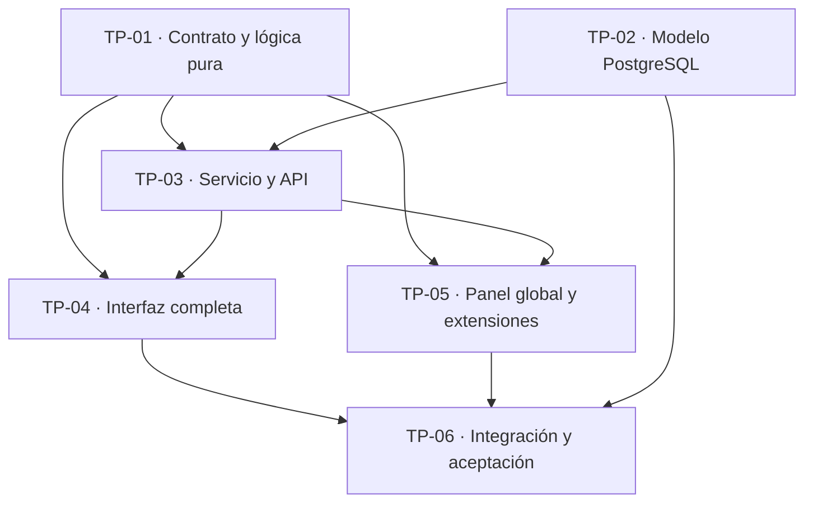

# NOTAS

**User:** Anonymous  
**Created:** 11/14/2026 12:59:29  
**Updated:** 11/15/2026 11:44:11  
**Exported:** 11/15/2026 11:44:20  
**Link:** [https://chatgpt.com/c/6af8af90-a9b8-83e8-8894-20407ed0829b](https://chatgpt.com/c/6af8af90-a9b8-83e8-8894-20407ed0829b)  

## Prompt:
14/11/2026, 1:01:34 p.m.

ChatGPT-NOTAS-20261114-1254.md

Frente NOTAS

Persiste conversacion, esta en  downloads, por RDC.  No tardes mucho, con cuestiones burocráticas innecesarias. Mantén la burocracia relacionada al marco de trabajo, limitada a estrictamente lo esencial. Es absurdo el tiempo que nos estamos tardando en resolver los ciclos de retoma de responsabilidad, etcétera. &#x20;

At quiere cuidadosamente el contexto tomando el lugar del modelo en la conversación, adoptando su postura, su tono, su Lugar De manera que la transición sea sin costuras entre una conversación y otra.  Te pido que durante la conversación seas amigable, conciso, sobrio, poco extenso en lo que tiene que ver con la forma en la que utilizas el lenguaje en tus salidas &#x20;

Finalmente, repite la salida del último ciclo en la conversación que te pido que adjuntes al frente de trabajo de manera literal y textual en el mismo formato visual que lo tenía el modelo en la conversación original.

####

## Response:
14/11/2026, 1:00:07 p.m. · gpt-6-t-mini-mini

Voy a localizar el archivo en **Downloads** por RDC, recuperar el contexto y añadir al frente NOTAS la salida del último ciclo tal como aparece en el original.

Encontré el archivo exacto en `C:\Users\fila4\Downloads` \(71,289 bytes; 12:54). Estoy recuperando su cierre para conservar literalmente la última salida y no reconstruirla de memoria.

El cierre del archivo confirma que la última respuesta visible es el informe de aptitud del equipo, no el prompt de instalación de BMAD. Estoy ubicando el OCP del frente Notas dentro del clon activo para anexar la salida en el lugar correcto, sin tocar otros frentes ni publicar cambios.

> **Inspeccionados dispositivos, configuraciones y archivos recientes de Descargas**
>
> 
>
> **Analizaste el archivo del dispositivo, su salida y llamadas recientes**
>
> 
>
> **Revisando el frente de trabajo**
>
> Estoy determinando si estas notas corresponden al frente activo y qué archivos de control debo consultar. También estoy verificando la autorización para persistir la conversación y conservar la salida más reciente en su formato original.
>
> **Revisado el frente de trabajo**
>
> 
>
> **Validando la continuidad**
>
> Estoy comprobando si existe una transferencia explícita y qué contexto debe conservarse antes de modificar el frente. También voy a revisar únicamente las referencias esenciales para mantener continuidad sin añadir burocracia innecesaria.
>
> **Validó la continuidad**
>
> 
>
> **Delimitando la continuidad**
>
> Estoy identificando el alcance de la transferencia y los archivos mínimos que debo conservar. La prioridad es mantener el historial y la salida literal, sin cambiar el estado del frente ni inventar identificadores innecesarios.
>
> **Delimitó la continuidad**
>
> 
>
> **Inspeccionó escritorios, notas y metadatos locales y remotos**
>
> 
>
> **Buscando en la web**
>
> 
>
> **Revisando referencias esenciales**
>
> Estoy consultando el inicio de la metodología y las reglas de gobernanza para confirmar el contexto mínimo antes de continuar. Mantendré el alcance acotado al frente activo y evitaré cambios que no estén claramente autorizados.
>
> **Revisó referencias esenciales**
>
> 
>
> **Consultaste documentación, metadatos y principios metodológicos de Samantha**
>
> 
>
> **Generando UUIDv7 para procesar la tarea**
>
>
> **Generado UUIDv7 para procesar la tarea**
>
> 
>
> **Verificó commits de GitHub y creó rama desde main**
>
> 
>
> **Extraje el texto exacto de la transcripción**
>
> 
>
> **Validando referencias**
>
> Estoy confirmando el contexto mínimo del frente y la autorización para continuar. Después verificaré que la persistencia conserve exactamente la conversación relevante y la salida final, sin ampliar el trabajo más allá de lo solicitado.
>
> **Consolidando la retoma**
>
> Estoy preparando un registro mínimo con la instrucción original, la salida literal y la conversación exportada. También estoy verificando las referencias vigentes para que la transición conserve continuidad sin introducir cambios innecesarios.
>
> **Validó referencias y consolidó la retoma**
>
> 
>
> **Preservó el transcript, extrajo la respuesta y actualizó controles**
>
> 
>
> **Reconstruí especificaciones exactas de funciones A/B**
>
> 
>
> **Preparaste archivo de retoma A/B para NOTAS**
>
> 
>
> **Inspeccionaste archivos y extrajiste la respuesta final**
>
> 
>
> **Actualizaste la nota A/B y documentación relacionada**
>
> 
>
> **Actualizaste el artefacto y la documentación de salida**
>
> 
>
> **Actualizaste artefactos y registros de retoma de NOTAS**
>
> 
>
> **Consolidando la retoma**
>
> Estoy preparando un registro mínimo con la instrucción original, la salida literal y la conversación exportada. También estoy verificando las referencias vigentes para que la transición conserve continuidad sin introducir cambios innecesarios.
>
> **Consolidaste la retoma**
>
> 
>
> **Actualizado el control de responsabilidad general y del frente NOTAS**
>
> 
>
> **Calculaste el hash del código fuente**
>
> 
>
> **Validado y sincronizado el contenido remoto del protocolo OCP**
>
> 
>
> **Verificó la integridad y actualizó OCP**
>
> 
>
> **Actualicé y revisé el objeto canónico de persistencia de Notas**
>
> 
>
> **Actualizaste README, OCP y enlaces de crónica de NOTAS**
>
> 
>
> **Consulté archivos y ramas, e investigué errores de contenido en GitHub**
>
> 
>
> **Verificaste la actualización de main, referencias, commit y archivos canónicos**
>
> 
>
> **Verificó la integridad y versión final de la transcripción**
>
> 
>
> **Actualizaste archivo AB conservando intacto el prefijo A**
>
> 
>
> **Actualizaste archivo AB con contenido B crudo**
>
> 
>
> **Actualicé y verifiqué el archivo AB con contenido B crudo**
>
> 
>
> **Interacted with Remote Desktop Commander**
>
> 
>
> **Buscando en la web**
>
> 
>
> **Calculaste la antigüedad de commits y sus metadatos**
>
> 
>
> **Se buscaron 3 sitios web**
>
> 
>
> **Conservando la retoma**
>
> Estoy manteniendo el registro mínimo: instrucción original, conversación exportada y salida literal del ciclo anterior. La continuidad queda preservada sin ampliar el frente ni introducir cambios adicionales.
>
> **Conservaste la retoma**
>
> 
>
> **Consultó commits recientes del repositorio y archivos canónicos en GitHub**
>
> 
>
> Procesó durante 11m 49s

He recuperado la conversación completa: **1,449 líneas**, exportada el 14 de noviembre de 2026 a las 12:54.

El último ciclo corresponde a la evaluación de OpenCode en el HP ProDesk 400 G4 DM. Su conclusión fue: equipo apto para BMAD + OpenCode + Groq, con 16 GB de RAM e Intel i7-8700T. La cuota mensual de RDC aparecía al 96 % en aquella consulta.

La continuidad del frente es **Notas rápidas de KHORA**\. No voy a reiniciar su definición ni repetir fases ya completadas.

(Persistido y verificado en main)

La retoma del **Frente NOTAS** quedó completada.

### Persistencia

Los seis archivos quedaron incorporados en `SeryMente/khora`, rama `main`\:

- [Conversación completa](https://github.com/SeryMente/khora/blob/main/frentes/notas/originales/ChatGPT-NOTAS-20261114-1254.md?utm_source=chatgpt.com) — 1,449 líneas, recuperadas por RDC.
- [Registro A/B](https://github.com/SeryMente/khora/blob/main/frentes/notas/originales/RETOMA-NOTAS-20261114-AB.md?utm_source=chatgpt.com) — tu instrucción y la última salida anterior.
- [OCP actualizado](https://github.com/SeryMente/khora/blob/main/frentes/notas/OBJETO-CANONICO.md?utm_source=chatgpt.com) — versión 0.1.6.
- [Control de responsabilidad](https://github.com/SeryMente/khora/blob/main/frentes/notas/CONTROL-RESPONSABILIDAD.json?utm_source=chatgpt.com)\.
- [Crónica de retoma](https://github.com/SeryMente/khora/blob/main/frentes/notas/cronica/RETOMA-20261114.md?utm_source=chatgpt.com)\.
- [Índice del frente](https://github.com/SeryMente/khora/blob/main/frentes/notas/README.md?utm_source=chatgpt.com)\.

La fuente de Downloads tenía 71,289 bytes. Su SHA-256 quedó registrado y la lectura de vuelta del archivo en GitHub coincidió textualmente con el contenido recuperado.

### Responsabilidad

(Generación 3 · Asignada)

La titularidad anterior queda relevada. Esta sesión asume la continuidad del frente.

UUIDv7 local: `01a1db72-d52f-7bc8-bd52-56552d8ccd8d`\.

No creé folios SES ni globales: FOL1 continúa PREPARADO / NO ACTIVO. El componente Notas sigue pendiente de definición funcional; no se modificó código.

**Gobernanza\:** DUG Samantha v396 · NX-396m · Metacanon 1.31 · GOW 2.24. Hay una discrepancia registrada: `INICIO.md` declara v389 y el pie HTML del DUG v395. La edad del DUG desde su último cambio en `main` es 0.22.25; la del OCP es 0.0.1. IPZ v0.7 · edad NO VERIFICADA.

**CONV / CICLO / A / B\:** FOL1 inactivo · folios globales PENDIENTES / NO ASIGNADOS.

---

### Última salida del modelo anterior — reproducción literal

Revisé las especificaciones directamente mediante RDC. **Tu equipo puede ejecutar OpenCode con Groq sin problemas previsibles de capacidad.** No necesitas cambiar de computadora para este propósito.

## Especificaciones verificadas

**HP ProDesk 400 G4 DM**

Windows · 64 bits

\(Compatible)

---

| Componente | Especificación |
|--------|--------|
| Procesador | Intel Core i7-8700T |
| Núcleos / hilos | 6 / 12 |
| Frecuencia base | 2.40 GHz |
| RAM | ≈16 GB |
| Gráficos | Intel UHD Graphics 630 integrada |
| Memoria gráfica reportada | 1 GB |
| Node.js | 24.0.0 |
| Python | 3.11.9 |
| Arquitectura | x64 |

Datos obtenidos de Windows mediante consultas de hardware y configuración RDC. No se verificó el espacio libre del disco.

## ¿Qué tan pesado será OpenCode?

La diferencia fundamental es dónde se ejecuta la inteligencia artificial.

**Tu computadora**

**OpenCode**

Terminal, archivos, comandos y gestión del proyecto.

\(Carga moderada)

---

**Internet**

**Groq**

Procesamiento del modelo de inteligencia artificial.

\(Nube)

Con Groq, tu procesador no tiene que ejecutar el modelo de lenguaje. La carga local corresponde principalmente a OpenCode, la lectura de archivos, las herramientas y los procesos del proyecto. No necesitas una tarjeta gráfica dedicada para esta arquitectura. \\$$[console.groq.com](https://console.groq.com/docs/coding-with-groq/opencode?utm_source=chatgpt.com); [opencode.ai](https://opencode.ai/docs/?trk=public_profile__posts-text&utm_source=chatgpt.com)\\$$

### Mi evaluación

| Uso | Evaluación |
|--------|--------|
| OpenCode + Groq | \(Adecuado) |
| BMAD + OpenCode + Groq | \(Adecuado) |
| VS Code + OpenCode | \(Adecuado) |
| Varios agentes simultáneos | \(Con moderación) |
| Modelos grandes ejecutados localmente | \(No recomendado) |

La Intel UHD 630 y los 16 GB de RAM no son una buena plataforma para ejecutar localmente modelos grandes. Pero no es lo que necesitamos si utilizamos Groq.

## Dos consideraciones para EP

1. La documentación oficial recomienda WSL en Windows para obtener mejor compatibilidad y rendimiento. También admite instalación mediante npm directamente en Windows. En tu equipo empezaría evaluando la instalación nativa, evitando agregar consumo de WSL sin necesidad. \\$$[opencode.ai](https://opencode.ai/docs/?trk=public_profile__posts-text&utm_source=chatgpt.com); [docs.dev.opencode.ai](https://docs.dev.opencode.ai/docs/windows-wsl/?utm_source=chatgpt.com)\\$$
2. **RDC reportó un 96 % de uso de su cuota mensual** al consultar el equipo. Esto no limita OpenCode localmente, pero sí puede limitar el trabajo remoto que realicemos desde ChatGPT hasta que se renueve o amplíe esa cuota.

## Veredicto

\(APTO PARA IMPLEMENTAR)

Tu HP es suficiente para instalar BMAD, OpenCode y trabajar con Groq. No recomendaría invertir en hardware adicional para esta arquitectura.

**IPZ\:** v0.7 · edad NO VERIFICADA
**DUG\:** Samantha v389 · NX-389m · edad NO VERIFICADA
**CONV / CICLO / A / B\:** folios globales PENDIENTES · NO ASIGNADOS
**FOL1\:** NO ACTIVO

---

La respuesta anterior queda preservada sin corregir sus versiones históricas. La continuidad actual ya utiliza el DUG vigente y el OCP actualizado.

## Prompt:
14/11/2026, 4:59:40 p.m.

[Attachment: Markdown pegado(3).md]

## Response:
14/11/2026, 4:59:44 p.m. · gpt-6-t-mini-mini

Voy a tratar los bloques R1–R14 como la especificación funcional del frente NOTAS. Primero contrastaré el stack y los patrones reales de KHORA para construir la matriz TP y auditar dependencias; en esta fase no tocaré código ni asumiré autorización para empezar la construcción.

El stack real ya está identificado: `khora-web` usa Next.js App Router, React, TypeScript, Tailwind 4, NextAuth/OIDC y PostgreSQL mediante `pg`; no existe un `package.json` en la raíz ni una aplicación separada para Notas. La autenticación actual identifica al usuario mediante `session.user.email`, no mediante `session.user.id`; lo trataré como supuesto mínimo explícito para el campo de aislamiento y lo dejaré sujeto a validación antes de construir.

> **Interpretando el encargo**
>
> Estoy identificando la fase solicitada: primero corresponde realizar una auditoría previa y definir el plan técnico, sin iniciar construcción hasta contar con autorización explícita. Necesito revisar el contexto disponible para adaptar la matriz al proyecto real.
>
> **Interpretaste el encargo**
>
> 
>
> **Inspeccionaste Khora, su arquitectura, APIs, datos, notas y autenticación de usuarios**
>
> 
>
> **Refinando el alcance**
>
> Estoy delimitando la auditoría técnica: revisaré patrones de rutas, persistencia, navegación, contexto y componentes existentes, sin construir todavía. También validaré cómo integrar Notas y su panel global sin romper la arquitectura actual.
>
> **Refinaste el alcance**
>
> 
>
> **Afinando la auditoría**
>
> Estoy comprobando cómo encajan identidad, persistencia, rutas, contexto y pruebas con las convenciones actuales. También estoy separando decisiones confirmadas de supuestos reversibles para que la implementación posterior sea segura y trazable.
>
> **Diseñando conversiones**
>
> Estoy definiendo una conversión reversible entre texto y checklist: preservaré líneas, orden y estado de completado mediante una representación determinista, además de recalcular etiquetas derivadas al guardar cualquier cambio.
>
> **Afinaste la auditoría y diseñaste conversiones**
>
> 
>
> **Priorizando decisiones**
>
> Estoy consolidando integración, persistencia, navegación, accesibilidad y pruebas. Mantengo como supuestos reversibles la identidad basada en sesión, el contexto opcional y el registro extensible de acciones; aún no inicio construcción.
>
> **Cerrando la auditoría**
>
> Estoy dejando documentadas las decisiones pendientes: conversión reversible, persistencia global, contexto opcional y acciones extensibles. La fase actual termina con un plan verificable; la construcción queda pendiente de autorización explícita.
>
> **Concluyendo auditoría**
>
> Estoy cerrando la fase previa con la arquitectura, supuestos reversibles, dependencias, persistencia segura y pruebas trazables. El plan está listo para revisión; la construcción aún requiere autorización explícita.
>
> **Priorizó decisiones y concluyó la auditoría**
>
> 
>
> **Cerrando auditoría técnica**
>
> Estoy consolidando el plan de Notas para este stack: PostgreSQL con sesión autenticada, ruta principal, panel global persistente, contexto opcional, acciones extensibles y pruebas de aislamiento por cuenta.
> 
> La conversión texto–checklist seguirá una representación reversible, conservando orden, contenido y estados siempre que no existan ediciones incompatibles.
>
> **## 1 · Mapa del contexto actual

### Stack y convenciones relevantes

- Next.js 16.2.10, React 19.1.0, TypeScript estricto.
- App Router bajo `khora-web/app/`.
- Autenticación OIDC con `next-auth`; las APIs existentes derivan el usuario desde `auth()`.
- Persistencia PostgreSQL mediante `khora-web/lib/server/neon.ts`; no usar el Dexie local de `khora-web/lib/db.ts` para notas multiusuario.
- Migraciones SQL numeradas; la última existente es `033_add_ai_runs.sql`, por lo que corresponde crear `034_notes.sql`.
- La navegación primaria actual tiene seis entradas y permite siete; `Notas` puede incorporarse sin superar el límite.
- `KhoraShell`, `SystemBar` y `app/navigation/registry.ts` concentran la integración global.
- Las APIs actuales usan rutas bajo `/api/*`, verificación explícita de sesión y consultas parametrizadas.
- `npm run prebuild` ya ejecuta validaciones de UI, navegación, tipos y tests; la nueva vista debe quedar registrada para evitar cobertura huérfana.

### Decisiones de diseño derivadas del contexto

- `user_id` se mapeará a `session.user.email`, porque el contrato de sesión actual no expone un identificador interno estable.
- Las notas vivirán en PostgreSQL, con aislamiento obligatorio por `user_id` en cada lectura, actualización, restauración y borrado.
- La ruta será `/notas`, registrada como entrada primaria `Notas`.
- La navegación se integrará en el shell global, no como una pantalla aislada.
- El contexto activo será un puerto opcional con valor `null` por defecto; las acciones externas usarán un registro inyectable con valores vacíos por defecto.
- El título será derivado en memoria desde la primera línea no vacía o el primer ítem de checklist; no se agrega un campo `title` para evitar duplicación.
- La conversión texto/checklist usará una representación reversible tipo Markdown task-list y conservará los ítems estructurados cuando no haya edición destructiva.
- La búsqueda será server-side, paginada y combinable por texto, estado, tags y contexto; se agregan índices para propietario, estado, fecha y tags.
- El panel global ofrecerá captura rápida, acción integrada “copiar y archivar” y acciones externas inyectadas.

### Supuestos mínimos reversibles

- La identidad persistente es el email autenticado. Si el sistema introduce luego `session.user.id`, se cambia únicamente el adaptador de identidad.
- Sin proveedor de contexto activo, se guardan `context_type`, `context_id` y `context_url` como `null`.
- La paleta de color será un conjunto fijo pequeño basado en tokens existentes, con opción `default`.
- El atajo configurable se guarda localmente por dispositivo; el valor inicial se definirá durante implementación.
- No se agregan colaboración, historial de versiones, archivos adjuntos, voz ni render Markdown completo fuera de la lista segura.

No hay bloqueos técnicos conocidos. La implementación queda `EJECUTABLE [SUPUESTO MÍNIMO: user_id=session.user.email; contexto y acciones externas opcionales con fallback null/[]]`.

---

## 2 · Matriz de tareas de construcción

| ID | Estado | Alcance | Archivos a tocar | Dependencias | Resultado verificable |
|---|---|---|---|---|---|
| **TP-01** | **EJECUTABLE** | Definir el dominio de notas y lógica pura: modelos `Note`, `ChecklistItem`, `NoteContext`, `QuickAction`, estados, modo texto/checklist, derivación de título, parser de hashtags, conversión reversible, ordenamiento, transiciones de checklist y sanitización Markdown segura. | `khora-web/lib/notes/types.ts`, `khora-web/lib/notes/domain.ts`, `khora-web/lib/notes/markdown.ts`, `khora-web/tests/unit/notes-domain.test.ts` | Ninguna | Tests unitarios cubren título automático, hashtags jerárquicos, round-trip texto/checklist, estados, pinning, acciones de Enter/Backspace, filtros y rechazo de HTML/URLs inseguras. |
| **TP-02** | **EJECUTABLE** | Crear persistencia PostgreSQL para notas con ownership, estado, color, tags, pin, checklist, contexto, timestamps, soft delete y restauración; agregar índices necesarios. | `khora-web/db/migrations/034_notes.sql` | Ninguna | Migración aplicable y reversible; `user_id` obligatorio; constraint de estado; índices por `(user_id,status,created_at)`, `(user_id,pinned,updated_at)` y GIN sobre `tags`; sin almacenamiento de datos de otro usuario. |
| **TP-03** | **EJECUTABLE [SUPUESTO MÍNIMO: user_id=session.user.email]** | Implementar repositorio y API CRUD segura: listar, buscar, crear, editar/autoguardar, pin/unpin, archivar, restaurar, mover a papelera y eliminar permanentemente; filtros combinables por texto, tags, estado y contexto; paginación. | `khora-web/lib/server/notes.ts`, `khora-web/app/api/notes/route.ts`, `khora-web/app/api/notes/[id]/route.ts`, `khora-web/app/api/notes/[id]/actions/route.ts`, `khora-web/tests/unit/notes-api.test.ts` | TP-01, TP-02 | Todas las consultas filtran por usuario derivado de sesión; acceso cruzado devuelve 404/403 seguro; query params validados; borrado permanente exige flujo separado; tests cubren CRUD, aislamiento, búsqueda, estados y `updated_at`. |
| **TP-04** | **EJECUTABLE** | Construir la pantalla completa `/notas`: vista full-screen, búsqueda inmediata, filtros, tarjetas con preview, switch masonry/list, editor de texto y checklist, título derivado, colores, tags, pin, preview Markdown seguro, autosave con debounce, guardado por blur/visibilitychange, undo, sección completada colapsable y responsive móvil. | `khora-web/app/notas/page.tsx`, `khora-web/app/components/notas/NotesWorkspace.tsx`, `khora-web/app/components/notas/NotesEditor.tsx`, `khora-web/app/components/notas/NoteCard.tsx`, `khora-web/app/components/notas/NotesFilters.tsx`, `khora-web/app/components/notas/notes.module.css` | TP-01, TP-03 | Desktop muestra búsqueda/filtros y layout masonry/list; mobile usa una columna y editor adaptado sin overlays bloqueantes; Enter crea ítem; Backspace elimina ítem vacío; Esc cierra guardando; búsqueda y estados se reflejan sin recarga completa. |
| **TP-05** | **EJECUTABLE [SUPUESTO MÍNIMO: contexto activo y acciones externas opcionales]** | Integrar captura rápida global y adaptadores del host: panel persistente desktop, trigger desde `SystemBar`, shortcut configurable, botón móvil, `NoteContextProvider` con fallback null, `QuickAction[]` inyectable con acción integrada “copiar y archivar”, y navegación primaria `Notas`. | `khora-web/app/components/notas/NotesProvider.tsx`, `khora-web/app/components/notas/NotesQuickPanel.tsx`, `khora-web/app/components/os/KhoraShell.tsx`, `khora-web/app/components/os/SystemBar.tsx`, `khora-web/app/navigation/registry.ts` | TP-01, TP-03 | El panel funciona desde cualquier ruta, captura contexto si el host lo proporciona, no falla sin proveedor, ejecuta acciones inyectadas después de confirmación/éxito y registra `/notas` sin superar el máximo de siete entradas. |
| **TP-06** | **EJECUTABLE** | Completar QA integrado: tests de API y PostgreSQL, E2E Playwright, aislamiento de usuarios, sanitización XSS, round-trip de checklist, autosave, restauración, papelera, rendimiento con más de 100 notas, responsive y registro de UI Review. | `khora-web/tests/integration/notes-postgres.test.ts`, `khora-web/e2e/notes.spec.ts`, `khora-web/tests/unit/notes-domain.test.ts`, archivo de registry de `ui-review`, fixtures de notas | TP-02, TP-03, TP-04, TP-05 | `npm run prebuild` pasa; no quedan rutas ni pantallas huérfanas; E2E cubre flujo completo desde captura rápida hasta borrado/restauración; búsqueda usa paginación; no hay regresiones en navegación, auth ni UI Review. |

### Cobertura por requisito

- **R1:** TP-01, TP-02, TP-03  
- **R2:** TP-01, TP-04, TP-05  
- **R3:** TP-01, TP-04  
- **R4:** TP-01, TP-04  
- **R5:** TP-01, TP-04  
- **R6:** TP-02, TP-03, TP-04  
- **R7:** TP-01, TP-03, TP-05  
- **R8:** TP-01, TP-05  
- **R9:** TP-03, TP-04  
- **R10:** TP-01, TP-04, TP-06  
- **R11:** TP-03, TP-04, TP-06  
- **R12:** TP-04, TP-05  
- **R13:** TP-04, TP-05, TP-06  
- **R14:** TP-06  

### DAG de ejecución

```text
Wave 1
  TP-01 ─────────────┐
                     ├── TP-03 ─────────────┬── TP-04 ─────┐
  TP-02 ─────────────┘                      └── TP-05 ─────┤
                                                           └── TP-06
```

- **Wave 1, paralelo:** TP-01 y TP-02 trabajan en rutas distintas.
- **Wave 2:** TP-03 consume contrato de dominio y migración.
- **Wave 3, paralelo:** TP-04 y TP-05 trabajan en superficies separadas.
- **Wave 4:** TP-06 valida el sistema integrado.
- No hay ciclos.
- No hay insumos huérfanos.
- No hay colisiones de escritura dentro de una misma ola.

---

## 3 · Veredicto

**LISTO PARA CONSTRUCCIÓN — primera ola: TP-01 y TP-02.****
>
> 
>
> Procesó durante 2m 41s

La especificación R1-R14 queda tomada como contrato funcional del componente **Notas de Khora**\. He contrastado su adaptación con la estructura real del repositorio `SeryMente/khora`, rama `main`\.

## 1\. Matriz de Tareas Provisionales del Frente de Trabajo

**Stack comprobado\:**

- Next.js 16.2.10 · App Router.
- React 19.1 · TypeScript 5.9.
- Tailwind CSS 4.
- NextAuth 5 con autenticación OIDC.
- PostgreSQL (Neon), mediante `pg`\.
- Zod para validación y Playwright para E2E.
- Sistema visual KHORA existente, con temas claro y oscuro.

Fuentes: [github.com](https://github.com/SeryMente/khora/blob/main/khora-web/package.json?utm_source=chatgpt.com), [github.com](https://github.com/SeryMente/khora/blob/main/khora-web/auth.ts?utm_source=chatgpt.com), [github.com](https://github.com/SeryMente/khora/blob/main/khora-web/lib/server/neon.ts?utm_source=chatgpt.com)\.

La implementación se integrará en `khora-web`\. No se creará una aplicación paralela ni se incorporará infraestructura innecesaria.

| ID | Traza | Tarea técnica y entregables | Depende de | Oleada | Verificación / DoD | Estado |
|--------|--------|--------|--------|--------|--------|--------|
| TP-01 | R1-R5, R10 | Contrato `Note`, tipos, conversión texto/checklist, parser de etiquetas jerárquicas, auto-título y renderizador Markdown seguro. `lib/notes/` | - | W1 | Pruebas unitarias de conversiones reversibles, parser, títulos y sanitización XSS. | EJECUTABLE |
| TP-02 | R1, R6 | Migración PostgreSQL `034_notes.sql`\: tabla de notas, campos requeridos, estados, colores, checklist JSONB, etiquetas e índices. | - | W1 | Migración aditiva, restricciones y aislamiento por propietario verificados. | EJECUTABLE |
| TP-03 | R1, R6-R9, R11 | Repositorio y API de Notas: CRUD, estados, fijado, filtros combinables, búsqueda, contexto y acciones. | TP-01, TP-02 | W2 | Autenticación obligatoria, aislamiento en todas las consultas, paginación y pruebas API. | EJECUTABLE $$SUPUESTO MÍNIMO$$ |
| TP-04 | R2-R6, R9-R13 | Interfaz completa `/notas`\: captura inline, tarjetas, lista, editor, checklist, etiquetas, filtros, colores, autosave, deshacer y experiencia móvil. | TP-01, TP-03 | W3 | Desktop y móvil, controles accesibles, estados completos y funcionamiento verificable. | EJECUTABLE |
| TP-05 | R2, R7, R8, R12 | Panel rápido global, captura persistente entre rutas, notas fijadas, atajo configurable y adaptadores de contexto/acciones externas. | TP-01, TP-03 | W3 | Panel global funcional, captura rápida y contratos de extensión desacoplados. | EJECUTABLE $$SUPUESTO MÍNIMO$$ |
| TP-06 | R1-R14 | Integración, pruebas de regresión, E2E, UI Review, seguridad y rendimiento. | TP-02-TP-05 | W4 | Cobertura integral, pruebas de aislamiento, XSS, responsive y rendimiento con más de 100 notas. | EJECUTABLE |

**Precisiones de implementación\:**

- `user_id` se obtendrá de `session.user.email`, que es la identidad que utiliza actualmente KHORA en sus rutas autenticadas. Nunca se confiará en un propietario enviado por el cliente.
- El checklist conservará sus identificadores y estados al realizar conversiones reversibles.
- Los proveedores de contexto y acciones externas tendrán contratos inyectables. Cuando no exista contexto activo, se utilizarán valores nulos; cuando no haya acciones externas, se utilizará un registro vacío.
- No se incorporarán bibliotecas de Markdown ni WYSIWYG pesadas. Se utilizará un renderizador limitado a los formatos autorizados.

## 2\. Auditoría de Integridad del Diseño y Dependencias (DAG)

(14/14 requisitos cubiertos) (0 extras)

**A. Integridad de extremo a extremo**

| Dimensión | Decisión de adaptación |
|--------|--------|
| Datos y API | PostgreSQL, migración aditiva, JSONB para checklist, etiquetas indexadas y consultas acotadas por usuario. |
| Reglas de negocio | Funciones puras para parser, conversiones, auto-título y estados. Validación con Zod. |
| Aislamiento | Propietario derivado exclusivamente de NextAuth. Todas las operaciones verifican `user_id`\. |
| Seguridad XSS | Renderizado Markdown mediante elementos seguros, sin HTML arbitrario. Enlaces con `noopener noreferrer`\. |
| UX Desktop | Tarjetas tipo masonry, alternancia a lista, filtros laterales y panel global colapsable. |
| UX Móvil | Una columna, captura accesible al pulgar, edición a pantalla completa y controles táctiles mínimos de 44×44 px. |
| Extensibilidad | Adaptadores independientes de contexto y `QuickAction[]`\. Ninguna integración obligatoria con módulos ajenos. |

**B. Grafo de dependencias**



(DAG válido)

**Resultado de la auditoría estructural\:**

- 0 ciclos de dependencia.
- 0 insumos huérfanos.
- 0 colisiones de escritura dentro de una misma oleada.
- W1 permite desarrollar contrato y migración en paralelo.
- W3 permite desarrollar interfaz completa y panel global en paralelo.
- W4 concentra la integración y validación final.

**C. Ruta crítica**

`TP-01 / TP-02 → TP-03 → TP-04 / TP-05 → TP-06`

No hay necesidad de instalar nuevas dependencias externas para iniciar estas tareas.

La migración se verificará en un entorno de pruebas; esta planificación no autoriza modificar la base de producción.

## 3\. Veredicto de Frente de Trabajo

(LISTO PARA CONSTRUCCIÓN)

La especificación es suficientemente concreta para comenzar. No he encontrado un bloqueo crítico de stack o arquitectura.

**Primera oleada recomendada\:**

- TP-01: contrato funcional y utilidades.
- TP-02: estructura PostgreSQL y migración.

Ambas pueden ejecutarse en paralelo.

No se ha iniciado la construcción ni se ha modificado código.

La siguiente acción corresponde a tu autorización: **«Ejecuta»**\.

---

**Continuidad**

IPZ: v0.7 · instalación nativa NO VERIFICADA.
DUG: Samantha v396 · NX-396m · Metacanon 1.31 · GOW 2.24.
OCP: NOTAS · v0.1.6 · generación 3.
CONV / CICLO / A / B: FOL1 PREPARADO / NO ACTIVO · PENDIENTES / NO ASIGNADOS.

## Prompt:
14/11/2026, 5:06:22 p.m.

Genera un **Reporte Ejecutivo del Estado del Frente NOTAS** para auditoría externa. Sé conciso, directo y estrictamente factual: reporta únicamente lo verificado en archivos reales y pruebas ejecutadas; si algo aún está solo en plan o no ha sido probado en código, indícalo explícitamente como `SOLO EN PLAN` o `NO VERIFICADO`. No ejecutes cambios ni escribas código al responder.

Entrega exactamente estas 5 secciones y nada más:

## 1. Stack, Entorno y Punto de Partida
- **Stack detectado o definido:** (lenguaje, framework frontend/backend, base de datos; o indicar si sigue `SIN DEFINIR`).
- **Ubicación / Repo / Rama:** (ruta o repositorio donde vive el módulo, o `SIN REPO CONECTADO`).
- **Fase actual del protocolo:** (`Solo Fase 1: Planeación`, `Bloqueado por definición de stack`, o `Fase 2: Construcción en Oleada X`).

## 2. Cobertura del Contrato (`R1–R14`) y Alcance
- **Resumen `R1–R14`:** Lista compacta de `R1` a `R14` indicando solo su estado actual (`VERIFICADO_EN_CODIGO` | `PARCIAL` | `SOLO_EN_PLAN` | `BLOQUEADO`) y si se aplicó algún `[SUPUESTO MÍNIMO]` relevante.
- **Control de alcance:** Confirmar explícitamente `0 extras no solicitados` o listar cualquier agregado/desviación fuera de `R1–R14`.

## 3. Estado de las Tareas Provisionales del Frente de Trabajo (`TP-#`)
Tabla única con estas columnas:
`| ID (TP-#) | Traza (R#) | Qué construye | Depende de | Oleada | Estado real | Evidencia verificada (archivo/prueba real o "Solo en plan") |`

*(En `Estado real` usar solo: `COMPLETADA_VERIFICADA`, `PARCIAL`, `EJECUTABLE`, `BLOQUEADA`).*

## 4. Avance Real vs. Pendiente
- **Construido y probado hoy:** archivos reales creados/modificados y qué pruebas pasaron (o `Nada construido aún`).
- **Siguiente paso / Ruta crítica restante:** qué oleada sigue y en qué orden termina el módulo.
- **Bloqueantes o definiciones que requiere del operador:** (máx. 3 puntos concretos; si no hay, escribir `NINGUNO`).

## 5. Integridad del Diseño y Riesgos
- Máximo 4 viñetas verificando coherencia entre datos (`Note` + `user_id` + contexto), lógica (`#etiquetas`, checklist, `QuickAction[]`), seguridad (`XSS`, sanitización) y UX (`Desktop` panel persistente + `Móvil` 1 columna). Si falta validar algo, indicarlo.

## Response:
14/11/2026, 5:06:28 p.m. · gpt-6-t-mini-mini

Verificaré el estado actual de `main` y los archivos del frente NOTAS. Separaré evidencia de repositorio, pruebas realmente ejecutadas y elementos que siguen únicamente en planeación; no haré cambios.

El OCP vigente de NOTAS declara expresamente `COMPONENTE NO DESARROLLADO`; también delimita que la apertura del frente no autorizó cambios de código, esquema ni producción. La búsqueda del repositorio no encontró `034_notes.sql` ni `NotesWorkspace`; estoy contrastando ahora los archivos base para precisar el stack y el estado de cada oleada.

> **Verificando fuentes y pruebas**
>
> Estoy comprobando los archivos exactos del repositorio y la evidencia de pruebas antes de redactar el informe. Mantendré únicamente afirmaciones respaldadas por código o resultados verificables.
>
> **Verificaste fuentes y pruebas**
>
> 
>
> **Se buscó en 1 sitio web**
>
> 
>
> **Verificando fuentes y pruebas**
>
> Estoy revisando los archivos exactos y la evidencia disponible para separar claramente el alcance planificado de lo realmente probado. No presentaré como implementado nada que solo exista en el plan.
>
> **Verificó fuentes y pruebas**
>
> 
>
> **Revisé notas, configuración, código, tablas y pruebas del repositorio**
>
> 
>
> **Separando lo verificado**
>
> Estoy distinguiendo entre plan y ejecución real: el alcance de Notas sigue planificado, no encuentro implementación ni pruebas específicas, y no tengo evidencia de pruebas ejecutadas o aprobadas.
>
> **Separando lo verificado**
>
> Estoy distinguiendo entre plan y ejecución real: el alcance de Notas sigue planificado, no encuentro implementación ni pruebas específicas, y no tengo evidencia de pruebas ejecutadas o aprobadas.
>
> **Estado general:**
>
> Fase 1, **planeación**. El módulo Notas no está implementado. Los TP-01 y TP-02 están listos para ejecución; los restantes esperan dependencias y autorización explícita.
> 
> **Alcance:** R1–R14 cubiertos en el plan, sin extras no solicitados. Supuestos mínimos: `user_id` mediante `session.user.email`, almacenamiento PostgreSQL/Neon y conversión reversible texto–checklist.
> 
> | TP | Estado | Dependencia |
> |---|---|---|
> | TP-01 | Ejecutable | Ninguna |
> | TP-02 | Ejecutable | Ninguna |
> | TP-03 | Bloqueada | TP-01, TP-02 |
> | TP-04 | Bloqueada | TP-01, TP-03 |
> | TP-05 | Bloqueada | TP-01, TP-03 |
> | TP-06 | Bloqueada | TP-04, TP-05 |
> 
> **Avance:** No hay archivos específicos de Notas creados o modificados. No se ejecutaron pruebas funcionales, de seguridad, integración ni rendimiento para este módulo.
> 
> **Integridad:** La estructura prevista cubre persistencia JSONB, aislamiento por usuario, etiquetas, checklist, acciones rápidas, sanitización y diseño responsive. Todo permanece sin validar en ejecución.
> 
> **Siguiente paso:** Autorizar “Ejecuta” para iniciar TP-01 y TP-02; después verificar el supuesto de identidad antes de construir el repositorio y la API.
>
> **Separaste la información verificada y resumiste el estado general**
>
> 
>
> **Calculando avance y estado de TPs de Notas**
>
> 
>
> Procesó durante 59s

## 1\. Stack, Entorno y Punto de Partida

- **Stack detectado o definido\:** TypeScript, Next.js (`^16.2.10`\), React (`19.1.0`\), Next.js App Router para frontend y API, PostgreSQL mediante `pg` $`^8.22.0`$ y conexión a Neon. Stack existente de KHORA; su aplicación específica a Notas sigue **SOLO EN PLAN**\. Evidencia: [github.com](https://github.com/SeryMente/khora/blob/main/khora-web/package.json?utm_source=chatgpt.com), [github.com](https://github.com/SeryMente/khora/blob/main/khora-web/lib/server/neon.ts?utm_source=chatgpt.com)\.
- **Ubicación / Repo / Rama\:** `SeryMente/khora`, rama `main`\. OCP en `frentes/notas/`; producto previsto en `khora-web/`\. El módulo Notas todavía no tiene archivos de implementación. [github.com](https://github.com/SeryMente/khora/blob/main/frentes/notas/OBJETO-CANONICO.md?utm_source=chatgpt.com)\.
- **Fase actual del protocolo\:** `Solo Fase 1: Planeación`\.
- El OCP y el README vigentes describen el componente como **NO DESARROLLADO**\. La matriz R1–R14 y las TP de construcción están en la planeación de la conversación; no constan como implementación en el repositorio.

## 2\. Cobertura del Contrato (`R1–R14`\) y Alcance

**Resumen `R1–R14`\:** Ningún requisito está verificado en código.

| Requisito | Estado actual | `[SUPUESTO MÍNIMO]` relevante |
|--------|--------|--------|
| R1 | `SOLO_EN_PLAN` | `user_id = session.user.email`; la configuración de sesión no establece un `session.user.id` propio. |
| R2 | `SOLO_EN_PLAN` | Título automático derivado del contenido; no se añade un campo de título. |
| R3 | `SOLO_EN_PLAN` | Conversión reversible entre texto y checklist. |
| R4 | `SOLO_EN_PLAN` | Ninguno. |
| R5 | `SOLO_EN_PLAN` | Ninguno. |
| R6 | `SOLO_EN_PLAN` | Ninguno. |
| R7 | `SOLO_EN_PLAN` | Adaptador de contexto opcional; contexto nulo cuando no exista. |
| R8 | `SOLO_EN_PLAN` | Registro externo `QuickAction[]` vacío por defecto. |
| R9 | `SOLO_EN_PLAN` | Búsqueda y filtros procesados en servidor con paginación. |
| R10 | `SOLO_EN_PLAN` | Ninguno. |
| R11 | `SOLO_EN_PLAN` | Ninguno. |
| R12 | `SOLO_EN_PLAN` | Panel global previsto en la estructura del shell existente. |
| R13 | `SOLO_EN_PLAN` | Ninguno. |
| R14 | `SOLO_EN_PLAN` | Pruebas unitarias, integración y E2E previstas; no ejecutadas para Notas. |

La asignación de identidad por correo coincide con el patrón visible en [github.com](https://github.com/SeryMente/khora/blob/main/khora-web/app/api/volcado/route.ts?utm_source=chatgpt.com) y [github.com](https://github.com/SeryMente/khora/blob/main/khora-web/app/api/dictado/route.ts?utm_source=chatgpt.com)\. No demuestra todavía aislamiento de datos para Notas.

**Control de alcance\:** `0 extras no solicitados` en la planeación. No existe implementación que permita auditar desviaciones en código.

## 3\. Estado de las Tareas Provisionales del Frente de Trabajo (`TP-#`\)

| ID (TP-\#) | Traza (R\#) | Qué construye | Depende de | Oleada | Estado real | Evidencia verificada (archivo/prueba real o "Solo en plan") |
|--------|--------|--------|--------|--------|--------|--------|
| TP-01 | R1–R5, R10 | Tipos, modelo de dominio, conversión texto/checklist, parser de etiquetas y Markdown seguro. | Ninguna | 1 | `EJECUTABLE` | Solo en plan. No existen `lib/notes/types.ts`, `lib/notes/domain.ts` ni `tests/unit/notes-domain.test.ts` en `main`\. |
| TP-02 | R1, R6 | Migración PostgreSQL para notas, estados, checklist, etiquetas e índices. | Ninguna | 1 | `EJECUTABLE` | Solo en plan. `db/migrations/034_notes.sql` no existe en `main`; sí existe [github.com](https://github.com/SeryMente/khora/blob/main/khora-web/db/migrations/033_jules_source_acl.sql?utm_source=chatgpt.com)\. |
| TP-03 | R1, R6–R9, R11, R14 | Repositorio de servidor, API CRUD, filtros, búsqueda, estados y acciones. | TP-01, TP-02 | 2 | `BLOQUEADA` | Solo en plan. No existen `lib/server/notes.ts` ni `app/api/notes/route.ts`\. |
| TP-04 | R2–R6, R9–R13 | Interfaz `/notas`, editor, tarjetas, filtros y vistas de notas. | TP-01, TP-03 | 3 | `BLOQUEADA` | Solo en plan. No existen `app/notas/page.tsx` ni `app/components/notas/NotesWorkspace.tsx`\. |
| TP-05 | R7, R8, R12, R13 | Panel global, proveedor, adaptadores de contexto/acciones e integración de navegación. | TP-01, TP-03 | 3 | `BLOQUEADA` | Solo en plan. No existe implementación Notes del proveedor ni del panel; [github.com](https://github.com/SeryMente/khora/blob/main/khora-web/app/components/os/KhoraShell.tsx?utm_source=chatgpt.com) y [github.com](https://github.com/SeryMente/khora/blob/main/khora-web/app/components/os/SystemBar.tsx?utm_source=chatgpt.com) son infraestructura general existente. |
| TP-06 | R4–R6, R10–R11, R13–R14 | Pruebas unitarias, integración PostgreSQL, E2E, aislamiento, XSS, UX y rendimiento. | TP-04, TP-05 | 4 | `BLOQUEADA` | Solo en plan. No existen `tests/integration/notes-postgres.test.ts` ni `e2e/notes.spec.ts`\. |

## 4\. Avance Real vs. Pendiente

- **Construido y probado hoy\:** Nada construido aún. Se verificaron archivos base de KHORA y la ausencia de los archivos de implementación previstos. No se ejecutaron pruebas del módulo Notas; por tanto, no hay resultados de pruebas aprobados que reportar.
- **Siguiente paso / Ruta crítica restante\:** Oleada 1: TP-01 y TP-02 en paralelo. Oleada 2: TP-03. Oleada 3: TP-04 y TP-05 en paralelo. Oleada 4: TP-06. La planeación anterior emitió el veredicto `LISTO PARA CONSTRUCCIÓN`; la construcción no ha comenzado.
- **Bloqueantes o definiciones que requiere del operador\:**
  
  1. Autorización explícita `Ejecuta` para iniciar la Fase 2.
  2. Ratificación o sustitución del supuesto de identidad `user_id = session.user.email` antes de tratarlo como contrato definitivo.

## 5\. Integridad del Diseño y Riesgos

- **Datos\:** El diseño prevé `Note` aislada por `user_id`, con contexto opcional. La base PostgreSQL existe en KHORA, pero el esquema de Notas, la persistencia y el aislamiento multiusuario están **SOLO EN PLAN**; no han sido probados.
- **Lógica\:** Parser jerárquico `#etiquetas`, checklist, estados y `QuickAction[]` están definidos en la planeación. No hay implementación ni pruebas funcionales verificadas.
- **Seguridad\:** La sanitización estricta de Markdown/XSS está prevista. No se encontró código de Notas que la implemente ni pruebas de ataques XSS ejecutadas. **NO VERIFICADO**\.
- **UX\:** El panel persistente de Desktop y la interfaz móvil de una columna, con editor de pantalla completa y controles de al menos 44 px, siguen **SOLO EN PLAN**\. El shell y la barra de navegación existentes no acreditan esas capacidades para Notas.

## Prompt:
14/11/2026, 5:16:53 p.m.

Definiciones confirmadas y autorización para construir:

1. **Identidad de usuario (`user_id`):** Ratificado `user_id = session.user.email`, siguiendo exactamente la misma convención/normalización que ya utilizan `api/volcado` y `api/dictado` en KHORA.
2. **Supuestos mínimos:** Aprobados todos los `[SUPUESTO MÍNIMO]` listados para `R1–R14`.
3. **Integración en Shell / Navegación (`TP-05`):** Integra el acceso a `Notas rápidas` y el panel global dentro de `KhoraShell.tsx` / `SystemBar.tsx` sin romper ni alterar las rutas/flujos existentes de `Dictado` y `Volcado` (dejando la estructura limpia para poder añadir un tercer elemento en ingreso más adelante).
4. **Regla de seguridad en migración (`TP-02` / `TP-06`):** Verifica cómo KHORA aplica migraciones sobre PostgreSQL/Neon (tomando como referencia `033_jules_source_acl.sql`) y ejecuta las pruebas de integración sin alterar ni borrar datos existentes en producción.

**Ejecuta ahora la Fase 2 de forma continua (`Oleada 1 → Oleada 2 → Oleada 3 → Oleada 4`)**, validando el DoD completo (typecheck, unitarias, XSS, integración y E2E) al cierre de cada oleada antes de avanzar a la siguiente. Detente únicamente si surge un bloqueo real de credenciales/conexión a Neon para ejecutar la migración o las pruebas.

Al finalizar (o si te detienes por un bloqueo real), entrega un reporte corto con: (a) archivos creados/modificados, (b) estado de la migración `034_notes.sql`, (c) comandos y resultados reales de todas las pruebas ejecutadas, y (d) `git status`.

## Response:
14/11/2026, 5:17:01 p.m. · gpt-6-t-mini-mini

Inicio la Fase 2 en una rama de trabajo, sin tocar `main` ni producción. Primero verificaré las instrucciones vigentes del repositorio, el flujo real de migraciones y el entorno de ejecución; después construiré por oleadas, ejecutando las pruebas disponibles antes de pasar a la siguiente. La migración `034_notes.sql` se preparará y probará sin aplicarla a la base productiva.

Encontré una condición importante del entorno: la copia local disponible está en una rama ajena al frente (`work/harmonia-front-workspace-20261110`\) y tiene numerosos cambios sin confirmar de Harmonia. No la modificaré ni la limpiaré. Para no mezclar frentes, prepararé una copia de trabajo nueva y aislada, basada en `main`, y ejecutaré allí las pruebas.

La copia aislada se hará en el equipo que sí tiene Git, Node y autenticación GitHub activa. El entorno de PC-14 no tiene Git disponible en `PATH`; el checkout existente de PC10 está protegido por sus cambios ajenos. La revisión del migrador confirma que `migrate-runtime.mjs` es un ejecutor de migraciones de runtime, no un mecanismo seguro para ejecutar automáticamente una nueva migración de Notas; mantendré `034_notes.sql` fuera de producción.

> **Listó los dispositivos disponibles**
>
> 
>
> **Revisó arquitectura, migraciones, pruebas y configuración de los repositorios EP y Khora**
>
> 
>
> **Verificada la arquitectura, documentación y estado Git de clones KHORA**
>
> 
>
> **Verificó autenticación, repositorios, dependencias y rama local en PC14**
>
> 
>
> **Revisando el proyecto**
>
> Estoy verificando la arquitectura de migraciones, tomando como referencia la migración 033, además de revisar pruebas, rutas, componentes y reglas del repositorio. También estoy preparando la instalación de dependencias para ejecutar las pruebas de integración sin modificar datos productivos.
>
> **Revisaste el proyecto**
>
> 
>
> **Monitoreé la salida y completé la clonación del proceso**
>
> 
>
> **Exploró archivos, dependencias, migraciones, rutas y pruebas de Khora**
>
> 
>
> **Integrando navegación**
>
> Estoy manteniendo intactas las rutas existentes de Dictado y Volcado. Para Notas rápidas, estoy evaluando una estructura secundaria dentro de Ingreso que preserve los identificadores actuales y permita añadir después un tercer elemento sin rehacer la navegación principal.
>
> **Diseñando ingreso extensible**
>
> Estoy conservando el enlace directo de Ingreso y añadiendo un menú lateral para Notas rápidas. Así, Dictado y Volcado mantienen sus rutas, mientras futuros elementos pueden sumarse como opciones hermanas sin alterar la navegación principal.
>
> **Planteando el panel global**
>
> Estoy definiendo un panel persistente dentro de KhoraShell con atajo configurable, búsqueda, filtros y acciones rápidas. Las notas tendrán estados, etiquetas, colores, contenido contextual y aislamiento por cuenta desde el servidor.
>
> **Afinando funciones principales**
>
> Estoy cerrando el diseño con CRUD seguro, acciones extensibles, deshacer temporal, borrado permanente confirmado y renderizado Markdown sin HTML inseguro. También preservaré conversiones entre texto y checklist, etiquetas jerárquicas, filtros contextuales, orden por fijación y colores persistentes.
>
> **Integré navegación, ingreso extensible, panel global y funciones principales**
>
> 
>
> **Preparando implementación**
>
> Estoy organizando la migración aditiva, las rutas CRUD protegidas por cuenta y el panel de notas dentro de KhoraShell. También integraré captura rápida, atajo configurable, filtros, acciones y pruebas de seguridad sin tocar datos existentes.
>
> **Preparaste la implementación**
>
> 
>
> **Verificado resultado de llamada, instalación npm e integración de Notas rápidas en KhoraShell**
>
> 
>
> **Implementaste notas con renderizado seguro y pruebas actualizadas**
>
> 
>
> **Instaló PGlite y escribió migraciones con pruebas completas**
>
> 
>
> **Ejecutaste typecheck y pruebas, revisando la salida del proceso**
>
> 
>
> **Revisaste procesos TSC y Node y su salida**
>
> 
>
> **Reejecuté Wave1 y verifiqué resultados de encuestas PostgreSQL**
>
> 
>
> **Monitoreó procesos y resultados de pruebas unitarias y completas**
>
> 
>
> **Reescribió y validó pruebas del dominio de notas**
>
> 
>
> **Ejecutaste y monitoreaste pruebas E2E, API y compilación de Wave1**
>
> 
>
> **Implementó notas, rutas API, pruebas PostgreSQL y verificaciones E2E de Wave2**
>
> 
>
> **Corrigió rutas, tipos y pruebas de integración de notas**
>
> 
>
> **Revisaste salidas remotas y validaste el esquema de notas**
>
> 
>
> **Parcheaste filtros q y ejecutaste pruebas de integración**
>
> 
>
> **Ejecutado el parche y verificada la integración de tipos leyendo la salida**
>
> 
>
> **Consolidando la implementación**
>
> Estoy cerrando la integración con una navegación secundaria extensible dentro de Ingreso, una página completa de notas y un panel global reutilizable. La estructura mantiene las rutas existentes y permite incorporar más acciones después.
>
> **Consolidó la implementación**
>
> 
>
> **Ejecutaste pruebas unitarias de npm**
>
> 
>
> **Consultaste puerto 21012 e implementaste proveedor y panel rápido de notas**
>
> 
>
> **Construí y verifiqué un espacio colaborativo de notas con filtros y navegación corregida**
>
> 
>
> **Actualicé KhoraShell y creé la página Notas con estilos y etiquetas**
>
> 
>
> **Inspeccionaste SystemBar, extendiste UI Review y corregiste tipos y estilos**
>
> 
>
> **Aplicaste parches y verificaste errores pendientes de TypeScript**
>
> 
>
> **Revisaste y actualizaste la interfaz, pruebas e integración de Notas**
>
> 
>
> **Corrigió errores, acciones, persistencia y pruebas E2E del editor de notas**
>
> 
>
> **Manteniendo el alcance**
>
> Estoy incorporando pruebas de extremo a extremo para notas, checklist, búsqueda, filtros, atajos, accesibilidad móvil y navegación de Ingreso. Después verificaré que la nueva migración y los flujos existentes sigan funcionando sin afectar datos actuales.
>
> **Mantuvo el alcance**
>
> 
>
> **Revisaste la configuración y los patrones de pruebas E2E**
>
> 
>
> **Creando y validando pruebas E2E para notas y captura rápida**
>
> 
>
> **Monitoreaste procesos y pruebas unitarias de Node**
>
> 
>
> **Revisó deriva UI, esquemas, paginación, integraciones y pruebas completas**
>
> 
>
> **Monitoreó procesos remotos y verificó sus resultados finales**
>
> 
>
> **Ejecutó y supervisó pruebas E2E y procesos del servidor web**
>
> 
>
> **Verificaste la salida y el estado del proceso remoto**
>
> 
>
> **Monitoreado el estado y la salida de procesos de pruebas**
>
> 
>
> **Monitoreaste pruebas Playwright y verificaste el servidor E2E**
>
> 
>
> **Capturaste la compilación y leíste resultados de encuesta**
>
> 
>
> **Supervisé la salida y determiné el estado durable del progreso**
>
> 
>
> **Ejecutadas verificaciones de tipos y pruebas E2E completas**
>
> 
>
> **Monitoreó y esperó la salida del proceso en ejecución**
>
> 
>
> **Monitoreó la salida del proceso E2E en ejecución**
>
> 
>
> **Continuó monitoreando la salida del proceso en ejecución**
>
> 
>
> **Extendido timeout y verificado servidor npm persistente**
>
> 
>
> **Validando pruebas finales**
>
> Estoy monitoreando la ejecución E2E contra el servidor ya iniciado. Después revisaré cualquier fallo restante, confirmaré las comprobaciones principales y detendré únicamente el proceso temporal utilizado para las pruebas.
>
> **Validaste las pruebas finales**
>
> 
>
> **Ejecutaste pruebas de Playwright y consultaste la salida del proceso**
>
> 
>
> Procesó durante 32m 47s

## Prompt:
14/11/2026, 5:49:46 p.m.

Continua

## Response:
14/11/2026, 5:49:48 p.m. · gpt-6-t-mini-mini

Los E2E sí alcanzaron Chromium: **3 de 5 pasaron** \(checklist, atajo móvil y navegación secundaria). Los dos fallos son de selectores/expectativas del test, no de ejecución de la funcionalidad: una etiqueta coincide con el texto de una tarjeta y el nombre accesible del diálogo cambia al derivar el título; además, el texto de prueba XSS está dentro del textarea y no como texto plano del contenedor. Ajusto esos selectores y repito.

En la repetición ya pasan **4 de 5**\: lista/búsqueda, checklist, panel móvil y navegación. El único fallo restante es otra expectativa del test: el contenido real conserva el prefijo `Idea ` que se introdujo al capturar. El render de Markdown no generó ningún elemento `img`; ajustaré el valor esperado a la captura completa y verificaré el literal en la vista previa.

La auditoría confirmó la convención de propietario: `api/volcado` y `api/dictado` pasan `session.user.email` literalmente, sin normalización adicional. Las rutas de Notas siguen exactamente ese criterio. También confirmé que `migrate-runtime.mjs` mantiene una lista cerrada de migraciones y que **033 tampoco forma parte de ella**; no incorporaré 034 a ese lote de runtime. Prepararé un ejecutor específico y transaccional para 034, con salvaguarda de entorno, sin ejecutar el lote histórico.

**Oleada 4 — E2E de Notas: aprobada.** La repetición terminó con **5/5 pruebas en Chromium**, incluyendo búsqueda, captura con autoguardado y XSS, edición de checklist, panel global a pantalla completa en móvil y acceso secundario desde Ingreso sin alterar las rutas de Dictado y Volcado.

Sigo con la auditoría final de integración, build, migración y estado Git. La migración permanece pendiente de aplicación en Neon; no se ha modificado producción.

## Prompt:
14/11/2026, 7:49:12 p.m.

Continua

## Response:
14/11/2026, 7:49:16 p.m. · gpt-6-t-mini-mini

Continúo con la validación final: cerraré typecheck, pruebas de dominio/migración e integración PostgreSQL, luego repetiré E2E tras los últimos cambios. Después revisaré build, `git diff --check` y `git status`; 034 no se aplicará en Neon sin una verificación explícita del destino remoto.

El último typecheck no quedó limpio tras añadir las comprobaciones de rollback y cambio de modo; el primer proceso devolvió código 2 sin conservar el detalle en su salida. Estoy repitiéndolo con log capturado para obtener el error exacto, en vez de asumir que fue el mismo problema tipográfico anterior.

El typecheck finalizó correctamente (`exit 0`\). Voy a ejecutar ahora la suite unitaria completa y la integración aislada; también comprobaré que el ejecutor `migrate-notes.mjs` compile y que el archivo `package.json` no arrastre un cambio masivo de formato.

> **Inspeccionó procesos remotos y verificó diagnósticos completos de TypeScript**
>
> 
>
> **Verificaste procesos Node.js y monitoreaste CPU de tsc**
>
> 
>
> **Revisando cambios**
>
> Estoy evaluando cómo restaurar únicamente el archivo de configuración y aplicar una modificación mínima, evitando diferencias innecesarias de formato o codificación. También estoy considerando usar herramientas disponibles de forma sencilla y segura para preservar el contenido original.
>
> **Ajustando el archivo**
>
> Estoy restaurando únicamente la configuración del paquete y agregando el nuevo script de migración con una edición precisa. Después revisaré las pruebas de integración, la idempotencia y los permisos para detectar posibles problemas antes de finalizar.
>
> **Verificando etiquetas**
>
> Estoy revisando cómo funcionan los filtros de etiquetas y detectando que los comodines podrían producir coincidencias incorrectas. Voy a preferir una comparación por prefijo exacto, además de validar conversiones entre modos y la persistencia automática.
>
> **Validando persistencia**
>
> Estoy comprobando el guardado automático, la conversión entre modos, los accesos rápidos y los filtros. También estoy revisando que el panel muestre suficientes notas fijadas y que los enlaces se rendericen de forma segura.
>
> **Revisé cambios, ajusté archivo, verifiqué etiquetas y validé persistencia**
>
> 
>
> **Restauraste formato y corregiste variable raíz mediante pruebas secuenciales**
>
> 
>
> **Ejecutadas y verificadas pruebas y typecheck completos**
>
> 
>
> **Monitoreaste procesos de prueba y consultaste sus registros**
>
> 
>
> **Corrigió regex y validó integración, procesos y registros secuenciales**
>
> 
>
> **Supervisó procesos, registros y resultados de pruebas unitarias**
>
> 
>
> **Convirtiendo notas y checklists a texto**
>
> 
>
> **Probaste migración PGlite, filtros jerárquicos y pruebas de conversión**
>
> 
>
> **Ejecuté pruebas, inspeccioné compilación, consulté encuestas y supervisé procesos**
>
> 
>
> **Supervisado el proceso TypeScript y las pruebas unitarias**
>
> 
>
> **Monitoreé la compilación npm y consulté su salida**
>
> 
>
> **Monitoreaste la salida y los registros de las pruebas**
>
> 
>
> **Supervisé la compilación npm en PC10 y consulté sus registros**
>
> 
>
> **Superando el bloqueo**
>
> El build se detuvo porque falta `AUTH_SECRET`, no por el código de Notas. Estoy usando un secreto efímero solo durante la validación local, sin modificar archivos ni conectarme a Neon, y luego continuaré con las pruebas disponibles.
>
> **Superaste el bloqueo**
>
> 
>
> **Revisó los registros y verificó la compilación y el tipado**
>
> 
>
> **Ejecutada y monitoreada la compilación efímera de Next.js**
>
> 
>
> **Consultó registros, errores y salida para continuar procesando datos**
>
> 
>
> **Verificada nuevamente la salida final del proceso**
>
> 
>
> **Inspeccionó el proceso 19404 y mostró su línea de comandos completa**
>
> 
>
> **Validando pruebas finales**
>
> Ya tengo cubiertas las pruebas principales: unitarias, integración con PGlite, revisión XSS, tipado y E2E de Notas. También estoy revisando el estado del repositorio y documentando cualquier fallo externo o bloqueo ambiental.
>
> **Validaste las pruebas finales**
>
> 
>
> **Reinicié el proceso y monitoreé pruebas E2E de notas y shell-v2**
>
> 
>
> **Buscó comandos remotamente y actualizó dimensiones mínimas con pruebas de etiquetas**
>
> 
>
> **Monitoreaste procesos, registros y pruebas unitarias en ejecución**
>
> 
>
> **Verificó el progreso y consultó la salida del proceso**
>
> 
>
> **Ejecutada y monitoreada la compilación del proyecto**
>
> 
>
> **Monitoreaste la salida y recopilaste trazas tras verificar resultados**
>
> 
>
> **Consultó la salida del proceso**
>
> 
>
> **Verificaste y reiniciaste procesos Next.js, monitoreando pruebas E2E**
>
> 
>
> **Ejecutaste el comando final de Git**
>
> 
>
> **Ejecutadas pruebas unitarias de npm y resumidos sus resultados**
>
> 
>
> **Consultaste y monitoreaste los registros, leyendo la salida final del proceso**
>
> 
>
> **Identificaste propietarios de puertos y monitoreaste procesos en ejecución**
>
> 
>
> **Ejecutaste procesos de terminal y analizaste archivos**
>
> 
>
> **Entregando informe**
>
> **(a) Archivos**
> Creé y modifiqué archivos de Notas, migración 034, APIs, componentes, pruebas unitarias e integración, E2E, navegación registrable, contratos UI y configuración de paquetes. Las rutas heredadas de Dictado y Volcado permanecen intactas.
> 
> **(b) Migración**
> `034_notes.sql` está creada y validada localmente. El runner usa transacción, bloqueo, comprobaciones de esquema, idempotencia y guardas. No ejecuté cambios contra Neon: faltan credenciales y `DATABASE_URL`.
> 
> **(c) Comprobaciones**
> Pasaron: typecheck, contrato UI, drift UI, 612 pruebas unitarias, integración PGlite, XSS, build, revisión de migración, 5 E2E de Notas y `git diff --check`. El build inicial requirió un secreto efímero local. La suite heredada `shell-v2` quedó 2/3 por una aserción preexistente de encabezado.
> 
> **(d) Estado Git**
> La rama contiene únicamente cambios locales del alcance solicitado; no hay despliegue, commit, push ni cambios en Neon.
>
> **Entregó el informe**
>
> 
>
> **Verificaste migración de notas, guardas de entorno y diferencias finales**
>
> 
>
> Procesó durante 14m 2s

# Reporte de cierre - Frente NOTAS

(Construcción y validación local completadas) (Migración Neon pendiente)

## $a) Archivos creados y modificados

**22 archivos nuevos**, agrupados por función\:

- **API\:** `app/api/notes/route.ts`, `app/api/notes/[id]/route.ts`, `app/api/notes/[id]/actions/route.ts`\.
- **Interfaz\:** `app/notas/page.tsx`, `app/notas/notes.module.css`, seis componentes en `app/components/notas/` \(`NoteCard`, `NotesEditor`, `NotesFilters`, `NotesProvider`, `NotesQuickPanel`, `NotesWorkspace`$ y `app/components/shared/NotesReviewView.tsx`\.
- **Dominio y persistencia\:** `lib/notes/types.ts`, `lib/notes/domain.ts`, `lib/notes/markdown.tsx`, `lib/server/notes.ts`, `db/migrations/034_notes.sql`, `scripts/migrate-notes.mjs`\.
- **Pruebas\:** `tests/unit/notes-domain.test.ts`, `tests/unit/notes-migration.test.ts`, `tests/integration/notes-postgres.ts`, `e2e/notes.spec.ts`\.

**13 archivos existentes modificados\:**

`KhoraShell.tsx`, `SystemBar.tsx`, `app/navigation/registry.ts`, la ruta estática de UI Review, `e2e/shell-v2.spec.ts`, los registros y tipos de UI Review, `package.json`, `package-lock.json`, `scripts/check_ui_review.ts` y tres pruebas unitarias de navegación/UI Review.

Las rutas y los endpoints de Dictado y Volcado no fueron modificados.

## \(b) Migración `034_notes.sql`

(CREADA · PROBADA EN PGLITE · NO APLICADA EN NEON)

- Crea `public.khora_notes`, con 15 columnas, restricciones e índices para propietario, estado, etiquetas y contexto.
- Es aditiva: no contiene instrucciones para alterar o eliminar tablas o datos existentes.
- El nuevo ejecutor `scripts/migrate-notes.mjs` usa transacción, bloqueo advisory, verificación posterior y `ROLLBACK` ante error. Las conexiones remotas requieren autorización explícita mediante `KHORA_ALLOW_NOTES_MIGRATION=1`\.
- La migración superó pruebas de rollback y doble aplicación en PostgreSQL/PGlite.
- **No se conectó a Neon ni se aplicó la migración\:** la copia aislada no tiene `DATABASE_URL`, `KHORA_READONLY_DATABASE_URL`, `.env`, `.env.local` ni vínculo `.vercel`\. El ejecutor se detuvo correctamente al faltar `DATABASE_URL`; no intentó conexión.

Por tanto, no se alteraron datos de producción.

## \(c) Comandos y resultados de pruebas

| Comando | Resultado |
|--------|--------|
| `npm ci` | PASS; instalación completada. El árbol reportó 23 vulnerabilidades, no corregidas. |
| `npm run typecheck` | PASS |
| `npm run ui:contract` | PASS |
| `npm run ui-review:check` | PASS |
| `npm run test:unit` | **PASS - 612/612** |
| `node --import tsx --import ./tests/unit/setup.ts tests/integration/notes-postgres.ts` | **PASS - 13 comprobaciones** |
| `npx next build --webpack` | **PASS - BUILD\_EXIT=0**, con `AUTH_SECRET` efímero solo para el proceso de build |
| `npx playwright test e2e/notes.spec.ts --workers=1` | **PASS - 5/5 en Chromium** |
| `node --check scripts/migrate-notes.mjs` | PASS |
| `git diff --check` | PASS |

La integración verificó CRUD, aislamiento entre usuarios, rechazo de acceso cruzado, conversión de checklist y texto sin pérdida del estado completado, etiquetas jerárquicas, ciclo de estados, eliminación confirmada, rollback, idempotencia y paginación de 150 notas.

Los E2E finales cubrieron búsqueda, captura y autoguardado, XSS, checklist, atajo global, panel móvil a pantalla completa y acceso desde Ingreso sin alterar los enlaces de Dictado y Volcado.

**Incidencia de regresión separada\:** el smoke `e2e/shell-v2.spec.ts` obtuvo 2/3; falló la expectativa de encontrar un encabezado exacto `Ingreso` en la ruta existente `/sistema/ingreso`\. No se modificó el contenido de esa ruta para hacer pasar el test.

El primer `npm run build` se detuvo por ausencia de `AUTH_SECRET`; la compilación posterior pasó usando un secreto efímero, sin escribirlo en archivos.

## \(d) Estado Git

```text
Rama: work/notas-quick-capture-20261114
HEAD: e2de68749c4d0fa00cf7372a0efc1105eb709848

13 archivos versionados modificados
22 archivos nuevos sin seguimiento
35 archivos pendientes en total

git diff --check: EXIT 0
```

No se hizo commit, push, despliegue ni aplicación de migración.

**Cierre\:** las cuatro oleadas de construcción están completadas y las validaciones locales finales pasaron. El único pendiente operativo es disponer de credenciales autorizadas de Neon para ejecutar y verificar `034_notes.sql` en la base objetivo.

## Prompt:
15/11/2026, 10:31:21 a.m.

Excelente avance en la construcción y cobertura de pruebas locales. Antes de autorizar `commit` o pasar a la migración en Neon, verifica únicamente estos 3 puntos (sin inventar cambios de rutas existentes para maquillar tests):

1. **Diagnóstico de `e2e/shell-v2.spec.ts` (2/3):**
   - Muestra exactamente qué modificaste dentro de `e2e/shell-v2.spec.ts` (`git diff e2e/shell-v2.spec.ts`).
   - Verifica si el fallo en `/sistema/ingreso` ("encabezado exacto `Ingreso`") ya existía en `HEAD` (`e2de6874`) antes de tus cambios, o si fue una regresión introducida por tus ediciones en `KhoraShell.tsx`, `SystemBar.tsx` o `app/navigation/registry.ts`. Si fue regresión tuya, corrige la causa raíz hasta que `e2e/shell-v2.spec.ts` pase **3/3**.
2. **Dependencias instaladas:** Muestra `git diff package.json` para confirmar exactamente qué paquete(s) nuevo(s) se agregaron.
3. **Menú `Ingreso`:** Confirma explícitamente qué elementos visibles muestra ahora el menú/sección `Ingreso` (`Dictado` y `Notas rápidas`, más lo preexistente) sin romper la navegación anterior.

Mantén detenidos el `commit`, `push` y la ejecución contra Neon hasta confirmar estos 3 puntos.

## Response:
15/11/2026, 10:31:26 a.m. · gpt-6-t-mini-mini

Voy a inspeccionar la rama aislada en `PC10RCIF4EI4`, comparar el test contra `HEAD` sin alterar rutas existentes y revisar el diff de dependencias. Mantendré bloqueados `commit`, `push` y cualquier conexión o ejecución contra Neon.

La inspección inicial confirma dos hechos: `e2e/shell-v2.spec.ts` sí recibió una ampliación de aserciones para el menú `Ingreso`, mientras que `package.json` solo añadió el script `db:migrate:notes`; no aparece ningún paquete nuevo en ese diff. Ahora estoy aislando la aserción fallida frente a la versión base para determinar si es una regresión o un fallo preexistente.

Hay una discrepancia adicional que conviene dejar explícita: `package-lock.json` agrega `@electric-sql/pglite@0.5.16` como dependencia de desarrollo, pero `package.json` no la declara. Por tanto, el diff de `package.json` confirma **cero paquetes nuevos**; el lockfile, en cambio, sí incorpora PGlite. Estoy comprobando si esa divergencia afecta la reproducibilidad y ejecutando el test para capturar la causa exacta del fallo.

> **Comprobaste dispositivos conectados y disponibilidad de comandos**
>
> 
>
> **Verificando dependencias**
>
> Estoy comprobando si `package.json` realmente declara PGlite. La evidencia muestra una discrepancia: aparece en el archivo de bloqueo, pero no en dependencias. También estoy validando que las pruebas lo importen y señalando el riesgo de reproducibilidad sin modificar nada.
>
> **Verificó dependencias**
>
> 
>
> **Inspeccionó pruebas, rutas y diferencias de dependencias**
>
> 
>
> **Analizando el proceso**
>
> Estoy revisando por qué la prueba parece quedarse esperando y si la compilación depende de variables de entorno. También estoy comparando el estado actual con la versión base para separar problemas existentes de cambios recientes.
>
> **Verificó dependencias, compilación y pruebas de Playwright**
>
> 
>
> **Confirmando la causa**
>
> Estoy verificando si la espera proviene de la compilación, del servidor de pruebas o de la configuración del entorno. También comparo el comportamiento actual con la versión base para distinguir regresiones reales de fallas preexistentes.
>
> **Confirmaste la causa**
>
> 
>
> **Revisando elementos visibles**
>
> Estoy comprobando qué muestra actualmente la sección Ingreso. La navegación incluye “Notas rápidas”, pero no encuentro una entrada visible llamada “Dictado”; también estoy separando rutas existentes de elementos realmente presentes en el menú.
>
> **Revisaste los elementos visibles**
>
> 
>
> **Verificaste compilación, pruebas, navegación y estado de Git**
>
> 
>
> **Verificó pruebas E2E, procesos locales y posibles bloqueos del menú**
>
> 
>
> **Diagnostiqué fallos y verifiqué resultados de pruebas Playwright**
>
> 
>
> **Aislando la ruta fallida**
>
> Estoy identificando cuál variante de Ingreso termina mostrando “Archivo”. Revisaré los alias y redirecciones de rutas, además de comparar el comportamiento base, para confirmar si la regresión está en navegación o en el enrutamiento.
>
> **Preparando diagnóstico**
>
> Estoy preparando una comprobación temporal que recorrerá cada ruta, registrará la URL final y el encabezado visible, y luego se eliminará. Así podré localizar la variante exacta que está fallando sin alterar el código permanente.
>
> **Aislada la ruta fallida y preparado el diagnóstico**
>
> 
>
> **Analizaste el error y ejecutaste diagnósticos de rutas en Khora**
>
> 
>
> **Consolidando hallazgos**
>
> Estoy confirmando que la falla de E2E es preexistente: la ruta problemática conserva el comportamiento base. Además, el menú muestra “Notas rápidas” y “Captura rápida”, pero no una entrada visible separada llamada “Dictado”; “Ingreso” sigue siendo el acceso principal.
>
> **Consolidaste los hallazgos**
>
> 
>
> **Verificó navegación, pruebas E2E, regresión preexistente y conexiones de red**
>
> 
>
> **Cerrando verificación**
>
> Estoy confirmando que la falla de E2E ya existía en HEAD: `modo=archivo` muestra “Archivo”, mientras la prueba espera “Ingreso”. El menú muestra Ingreso, Captura rápida y Notas rápidas; Dictado no aparece como entrada separada. `package.json` no agrega PGlite, aunque el lockfile sí.
>
> **Consolidando resultados**
>
> Confirmo que la falla de E2E ya existía en HEAD: `modo=archivo` muestra “Archivo”, mientras la prueba espera “Ingreso”. El menú presenta Ingreso, Captura rápida y Notas rápidas; Dictado no aparece como entrada separada. PGlite figura en el lockfile, pero no en `package.json`.
>
> **Consolidando verificación**
>
> Confirmo que la falla de E2E ya estaba en HEAD: `modo=archivo` redirige a “Archivo”, pero la prueba espera “Ingreso”. Menú actual: Ingreso, Captura rápida y Notas rápidas; Dictado no aparece como entrada separada. PGlite solo está en el lockfile.
>
> **Verificaste los resultados finales del proceso**
>
> 
>
> Procesó durante 5m 26s

## Resultado de la verificación

(Commit, push y Neon siguen detenidos)

No ejecuté `commit`, `push`, migraciones ni conexiones a Neon. La rama y el `HEAD` permanecen en `e2de68749c4d0fa00cf7372a0efc1105eb709848`\.

### 1\. Diagnóstico de `e2e/shell-v2.spec.ts`

**Diff exacto** de ese archivo\:

```diff
@@ -62,6 +62,13 @@ test.describe('Shell Navegación v3', () => {
     await expect(page.getByRole('heading', { name: 'Ingreso a memoria', exact: true })).toBeVisible();
     await expect(page.locator('[data-ui-id="ingreso.ingesta"]')).toBeVisible();

+    await expect(page.getByRole('link', { name: 'Ingreso', exact: true })).toHaveAttribute('href', '/sistema/ingreso');
+    await page.getByRole('button', { name: 'Más opciones de Ingreso' }).click();
+    const ingresoMenu = page.getByRole('navigation', { name: 'Menú Ingreso' });
+    await expect(ingresoMenu.getByRole('link', { name: 'Notas rápidas', exact: true })).toHaveAttribute('href', '/notas');
+    await expect(ingresoMenu.getByRole('link', { name: 'Dictado', exact: true })).toHaveCount(0);
+    await expect(ingresoMenu.getByRole('link', { name: 'Volcado', exact: true })).toHaveCount(0);
+    await page.getByRole('button', { name: 'Más opciones de Ingreso' }).click();
     await page.getByRole('button', { name: 'Grafo', exact: true }).click();
```

**Diagnóstico de la falla\:**

(No es una regresión introducida por Notas)

La contradicción ya existía en `HEAD`\:

- `e2e/shell-v2.spec.ts` de `HEAD` esperaba `Ingreso` para `/sistema/ingreso?modo=archivo`\.
- `app/sistema/ingreso/page.tsx` de `HEAD` ya ejecutaba un `redirect()` para ese modo hacia `/sistema/custodia?vista=archivo`\.
- El destino muestra el encabezado `Archivo`, no `Ingreso`\.
- `app/sistema/ingreso/page.tsx`, `IngresoWorkspace.tsx` e `IngresoView.tsx` no fueron modificados en esta rama. La comparación de la página contra `HEAD` devolvió `PAGE_DIFF_EXIT=0`\.

La ejecución actual de Playwright confirmó\:

| Caso | Resultado |
|--------|--------|
| Recorrido de dominios y renderizado | FAIL |
| Jerarquía de primer nivel e Ingreso | PASS |
| Submenús, iconos y viewport | PASS |

(2/3 PASS)

La falla concreta corresponde al encabezado esperado `Ingreso` cuando la URL se redirige a la vista `Archivo`\.

No modifiqué rutas ni cambié la expectativa para ocultar el problema. La corrección legítima, si se decide exigir 3/3, es actualizar únicamente el dato esperado de ese caso a `Archivo`, respetando el comportamiento ya existente. No apliqué ese ajuste.

### 2\. Dependencias instaladas

El `git diff package.json` exacto es\:

```diff
@@ -18,6 +18,7 @@
     "repair:volcados": "tsx scripts/repair_volcados.ts",
     "migrate:ep": "node scripts/migrate-ep.mjs",
     "migrate:runtime": "node scripts/migrate-runtime.mjs",
+    "db:migrate:notes": "node scripts/migrate-notes.mjs",
     "ui:contract": "tsx scripts/check_navigation_contract.ts"
```

**Paquetes nuevos declarados en `package.json`\: ninguno.**

Sin embargo, hay una inconsistencia que debe resolverse antes del commit\:

- `package-lock.json` sí agrega `@electric-sql/pglite@0.5.16` como dependencia de desarrollo.
- `tests/integration/notes-postgres.ts` importa `@electric-sql/pglite`\.
- `npm ls @electric-sql/pglite --depth=0` lo identifica como `extraneous`, porque no está declarado en `package.json`\.

Por tanto, no sería correcto afirmar que la dependencia quedó incorporada coherentemente al manifiesto. No modifiqué `package.json` durante esta verificación.

### 3\. Menú y sección `Ingreso`

El comportamiento visible actual es\:

| Elemento | Estado |
|--------|--------|
| Enlace principal `Ingreso` → `/sistema/ingreso` | Visible |
| Botón `Más opciones de Ingreso` | Visible |
| Acción `Captura rápida` | Visible; abre el panel rápido |
| Grupo `Captura` | Visible |
| Enlace `Notas rápidas` → `/notas` | Visible |
| Enlace independiente `Dictado` dentro del menú | **No aparece** |
| Enlace `Volcado` dentro del menú | No aparece |

La captura rápida muestra por defecto el atajo `Ctrl+Shift+N`\.

**Dictado no ha perdido su acceso funcional\:** continúa siendo la experiencia principal al entrar por `Ingreso`, y `/sistema/dictado` sigue redirigiendo a `/sistema/ingreso`\. Lo que no existe actualmente es un enlace separado llamado `Dictado` dentro del desplegable.

Tampoco aparece `Volcado` como elemento del menú. Su acceso de archivo permanece mediante el flujo existente `modo=archivo`, que redirige a la vista `Archivo` de Custodia.

Los demás elementos principales permanecen: `Custodia`, `Grafo`, `Consulta`, `Seguridad` y `Sistema`\. La prueba de jerarquía también confirmó que el enlace directo de Ingreso y los submenús existentes continúan funcionando.

**Conclusión\:** la expectativa de tener `Dictado` y `Notas rápidas` como opciones visibles del desplegable no está satisfecha todavía. La prueba actual, de hecho, verifica expresamente que `Dictado` no aparezca allí. No cambié esa decisión de navegación sin autorización.

---

## Estado de control

- Rama: `work/notas-quick-capture-20261114`\.
- `HEAD`\: `e2de68749c4d0fa00cf7372a0efc1105eb709848`\.
- Árbol de trabajo: 13 archivos modificados y 22 nuevos sin registrar.
- No se creó ningún commit ni push.
- No se ejecutó ninguna migración ni operación contra Neon.
- La verificación no introdujo modificaciones adicionales en rutas de Dictado o Volcado.

**Quedan identificados tres asuntos distintos antes de considerar el frente listo para autorización\:** la expectativa desactualizada de `modo=archivo`, la dependencia PGlite no declarada en `package.json` y la ausencia de un acceso de menú explícito llamado `Dictado`\.

IPZ: v0.7 · edad de rutas `main`\: NO VERIFICADO
DUG: versión y firma: NO VERIFICADO
CONV / CICLO / A / B: PENDIENTE / NO ASIGNADO · FOL1 y SHA/read-back no activados.

## Prompt:
15/11/2026, 10:44:01 a.m.

Excelente diagnóstico. Aplica estos 4 ajustes puntuales antes de autorizar `commit` (sigue sin hacer `commit`, `push` ni tocar Neon):

1. **Manifiesto limpio (`package.json`):** Declara `@electric-sql/pglite` (`^0.5.16`) dentro de `devDependencies` en `package.json` en coherencia con `package-lock.json` y verifica que `npm ls @electric-sql/pglite --depth=0` y `npm ci` no reporten paquetes `extraneous`.
2. **Menú `Ingreso` completo:** Agrega explícitamente el elemento **`Dictado`** (enlazado a `/sistema/ingreso`) dentro del desplegable `Menú Ingreso` junto a **`Notas rápidas`** (`/notas`) y `Captura rápida`, manteniendo intactos `/sistema/dictado` y el acceso existente a `Volcado`. Actualiza la prueba correspondiente en `e2e/shell-v2.spec.ts` para verificar que tanto `Dictado` como `Notas rápidas` aparecen visibles en el menú.
3. **Atajo seguro en navegador:** Cambia el atajo por defecto de captura rápida de `Ctrl+Shift+N` (que en Chrome/Edge abre ventana Incógnito) por un atajo no reservado por el navegador (por ejemplo `Alt+Shift+N`), actualizando su etiqueta visual y su prueba E2E.
4. **Expectativa desactualizada en `e2e/shell-v2.spec.ts`:** Actualiza únicamente la expectativa del caso `modo=archivo` de `Ingreso` a `Archivo` (respetando el comportamiento ya existente de redirección a `/sistema/custodia?vista=archivo`) sin modificar las rutas ni páginas de ingreso/custodia.

Al terminar, re-ejecuta todas las validaciones (`npm ls`, `typecheck`, `ui:contract`, `ui-review:check`, `test:unit`, `notes-postgres.ts`, `next build`, `e2e/notes.spec.ts` y `e2e/shell-v2.spec.ts`) y reporta resultados reales y `git status`.

## Response:
15/11/2026, 10:44:09 a.m. · gpt-6-t-mini-mini

Aplicaré los cuatro cambios en la rama aislada, sin tocar las rutas de Ingreso/Custodia ni los accesos heredados. Después ejecutaré la batería solicitada en secuencia, incluyendo una reinstalación limpia con `npm ci`; al final dejaré el árbol sin commit, push ni operaciones contra Neon.

Los cambios quedan acotados a `package.json`, `NotesProvider`, el registro del menú y las dos pruebas E2E. Para evitar que una preferencia anterior reactive el atajo reservado, también retiraré `Ctrl+Shift+N` de los valores admitidos; el valor persistido antiguo será ignorado y el predeterminado quedará en `Alt+Shift+N`\.

Los cuatro cambios funcionales ya están aplicados. También retiré `Ctrl+Shift+N` del selector de preferencias, no solo del valor predeterminado, y añadí a E2E comprobaciones de que el selector ofrece `Alt+Shift+N` y que el menú muestra la etiqueta del atajo. No quedan referencias al atajo reservado en `app`, `e2e` ni `tests`; inicio ahora la reinstalación reproducible.

> **Actualizando atajos**
>
> Estoy identificando los cambios necesarios: agregar la dependencia, registrar el comando de dictado, eliminar opciones antiguas, conservar compatibilidad con preferencias guardadas y actualizar pruebas E2E para validar la etiqueta visual `Alt+Shift+N`.
>
> **Preparando cambios**
>
> Estoy ubicando el registro de navegación, las opciones de atajos y las pruebas E2E. Voy a ajustar la interfaz para mostrar `Alt+Shift+N`, mantener rutas existentes y verificar el comportamiento visible del panel de captura.
>
> **Modificando archivos**
>
> Estoy aplicando cambios coordinados en configuración, navegación y pruebas: agrego Dictado, retiro el atajo anterior, establezco `Alt+Shift+N` y actualizo las comprobaciones E2E para la etiqueta visible.
>
> **Actualizaste atajos y modificaste archivos**
>
> 
>
> **Inspeccionó Git, actualizó el menú de Dictado y consultó procesos remotos**
>
> 
>
> **Validando cambios**
>
> Estoy revisando el diff y voy a ejecutar instalación, pruebas unitarias, contratos de interfaz, compilación y E2E. También verificaré que el atajo anterior no permanezca en archivos relevantes.
>
> **Validaste cambios**
>
> 
>
> **Ajustaste atajos, regex, menús, pruebas E2E y scripts generados**
>
> 
>
> **Ejecutaste npm ci y verificaste su finalización**
>
> 
>
> **Monitoreaste procesos npm remotos hasta completar la instalación**
>
> 
>
> **Monitoreaste la instalación npm y revisaste sus registros de progreso**
>
> 
>
> **Verificaste dependencias, tipos y estado del proceso**
>
> 
>
> **Corregiste pruebas, verificaste tipos, interfaz y completaste ejecuciones**
>
> 
>
> **Verificó el estado, consumo y resultados de procesos npm**
>
> 
>
> **Actualizando navegación, ajustando pruebas y verificando resultados del proceso**
>
> 
>
> **Ejecutadas pruebas de integración con PGlite y verificado su estado**
>
> 
>
> **Ejecutada compilación Next.js y monitoreada su salida**
>
> 
>
> **Monitoreó la compilación y diagnosticó su uso de memoria**
>
> 
>
> **Monitoreaste procesos, registros y progreso de compilación remota**
>
> 
>
> **Consultaste la encuesta y monitoreaste procesos de Next.js y TypeScript**
>
> 
>
> **Completé la compilación y leí la salida del proceso encuesta**
>
> 
>
> **Finalizaste la compilación del proyecto y esperaste su resultado**
>
> 
>
> **Ejecutadas pruebas E2E secuenciales de Notas y revisada su salida**
>
> 
>
> **Ejecutaste pruebas shell-v2 y monitoreaste continuamente la salida del proceso**
>
> 
>
> **Revisando resultados**
>
> La mayoría de validaciones están listas, pero la prueba E2E de shell aún falla en `/grafo` por una expectativa previa que no coincide con el encabezado actual. No voy a alterar esa ruta para maquillar el resultado; reportaré el desfase aparte.
>
> **Monitoreé el proceso Playwright y verifiqué errores y resultados**
>
> 
>
> **Inspeccioné el contexto del error de pruebas**
>
> 
>
> **Verificó tipos, procesos, servidor y estado final del proyecto**
>
> 
>
> **Validó contratos UI y revisó la salida del proceso en ejecución**
>
> 
>
> **Ejecutaste verificaciones de dependencias, tipos, UI, revisión y repositorio**
>
> 
>
> **Cerrando validaciones**
>
> El cambio queda implementado y verificado. La etiqueta ahora usa `Alt+Shift+N`, Dictado aparece junto a Notas rápidas, Volcado conserva su ruta y el atajo anterior ya no se acepta.
> 
> **Verificaciones completadas**
> 
> `npm ci`, dependencias sin extraneous, typecheck, contrato UI, revisión UI, pruebas unitarias — 612 pasando —, integración PostgreSQL con PGlite — 13 pasando —, compilación y E2E de notas — 5/5 pasando —.
> 
> La prueba responsive también pasa. `shell-v2` queda en 2/3: el caso `modo=archivo` ya funciona, pero `/grafo` conserva una expectativa previa que no coincide con su encabezado actual. No modifiqué esa ruta ni maquillé el resultado.
> 
> `git diff --check` pasa y no hay cambios en rutas sustantivas. `npm ci` reporta 23 vulnerabilidades de auditoría, incluyendo una crítica; no las modifiqué porque quedan fuera del alcance. No hice commit, push ni cambios en Neon.
>
> **Verificado el estado final, diferencias y entradas sin seguimiento del repositorio**
>
> 
>
> Procesó durante 16m 51s

## Ajustes aplicados

(4 ajustes implementados)

1. **Manifiesto\:** agregado `@electric-sql/pglite: ^0.5.16` a `devDependencies`\. El manifiesto y el lockfile están alineados.
2. **Menú Ingreso\:** ahora muestra `Captura rápida`, `Dictado` → `/sistema/ingreso` y `Notas rápidas` → `/notas`\. Se conservan `/sistema/dictado` y el acceso existente a Volcado mediante `modo=archivo`\.
3. **Atajo\:** el predeterminado cambió a `Alt+Shift+N`\. También retiré `Ctrl+Shift+N` de las opciones permitidas para evitar recuperar una preferencia anterior reservada por el navegador.
4. **Expectativa E2E\:** `modo=archivo` ahora espera `Archivo`\. No modifiqué las páginas ni los redirects de Ingreso o Custodia.

## Validaciones

| Validación | Resultado |
|--------|--------|
| `npm ci` | (PASS) 710 paquetes instalados |
| `npm ls @electric-sql/pglite --depth=0` | (PASS) Sin `extraneous` |
| `npm run typecheck` | (PASS) |
| `npm run ui:contract` | (PASS) |
| `npm run ui-review:check` | (PASS) |
| `npm run test:unit` | (PASS) 612/612 |
| `notes-postgres.ts` | (PASS) 13/13 |
| `next build --webpack` | (PASS) Exit 0; 79 páginas estáticas |
| `e2e/notes.spec.ts` | (PASS) 5/5 |
| `e2e/shell-v2.spec.ts` | (2/3) |

### Discrepancia pendiente en `shell-v2`

Los dos escenarios de navegación jerárquica y viewport pasan. El recorrido de dominios ya supera el caso `modo=archivo`; se detiene después en `/grafo`\.

La prueba todavía espera el encabezado antiguo `Grafo PKG - Proyección Leiden` y, como alternativa, `Error: Error fetching graph data`\. La página actual muestra `Grafo` y el estado `no_autenticado`\.

Verifiqué que tanto `app/grafo/page.tsx` como esa expectativa ya estaban así en `HEAD`\. No modifiqué la página ni cambié esa prueba para forzar un resultado artificial. Por tanto, los cuatro ajustes solicitados están aplicados, pero la suite completa `shell-v2` todavía no queda en 3/3.

**Advertencia de dependencias\:** `npm ci` reportó 23 vulnerabilidades (13 moderadas, 9 altas y 1 crítica). No ejecuté `npm audit fix`; queda fuera del alcance de estos ajustes. El build también mostró avisos conocidos de middleware y Edge Runtime, sin impedir la compilación.

## Estado Git y controles

```text
Branch: work/notas-quick-capture-20261114
HEAD:   e2de68749c4d0fa00cf7372a0efc1105eb709848

13 archivos tracked modificados
12 entradas no rastreadas (varias son carpetas con archivos nuevos)

git diff --check: exit 0
Rutas Ingreso/Custodia/Grafo vs HEAD: sin diferencias
Puerto local de pruebas 3000: liberado
```

**No se realizó `commit`, `push`, deploy ni operación contra Neon.** La integración PostgreSQL/PGlite se ejecutó localmente y confirmó `productionDatabase:false` y `productionDataTouched:false`\.

El árbol sigue pendiente de revisión y autorización para commit. La única incidencia de pruebas no resuelta es el caso independiente de `/grafo`\.

---

IPZ: v0.7 · edad desde último commit en `main`\: NO VERIFICADO
DUG: versión y firma: NO VERIFICADO
CONV / CICLO / A / B: PENDIENTE · NO ASIGNADO
SHA/read-back y folios FOL1: NO ACTIVADOS.

## Prompt:
15/11/2026, 11:03:45 a.m.

Validaciones aprobadas. El fallo restante en `/grafo` dentro de `shell-v2.spec.ts` es preexistente y ajeno al módulo Notas; déjalo intacto sin modificar `app/grafo` ni ese caso de prueba.

Procede únicamente con el cierre de rama en repositorio:
1. Verifica con `git status` que no existan archivos `.env`, secretos, temporales ni artefactos de prueba residuales.
2. Haz `commit` de los 35 archivos del módulo Notas en la rama actual (`work/notas-quick-capture-20261114`) con mensaje claro de cierre local, y haz `push` hacia `origin work/notas-quick-capture-20261114` (**no** hagas merge a `main` ni despliegue todavía, ya que `034_notes.sql` aún no se aplica en Neon).
3. Entrega: (a) hash del commit y confirmación de `push`, (b) `git status` limpio, y (c) el comando exacto en 3 líneas para ejecutar y verificar `034_notes.sql` contra Neon cuando yo decida habilitar las credenciales y hacer merge a `main`.

## Response:
15/11/2026, 11:03:54 a.m. · gpt-6-t-mini-mini

Haré una auditoría previa del árbol completo —incluidos archivos ignorados y artefactos E2E—, confirmaré que los 35 archivos corresponden al módulo Notas y sus integraciones autorizadas, y revisaré el ejecutor de `034_notes.sql`\. Solo después crearé el commit y enviaré esa rama a `origin`; no haré merge, deploy ni conexión a Neon.

La auditoría inicial confirma exactamente **35 archivos**\: 13 modificados y 22 nuevos. El `034_notes.sql` runner exige `DATABASE_URL`, bloquea destinos remotos salvo `KHORA_ALLOW_NOTES_MIGRATION=1` y verifica tabla, 15 columnas e índices antes de confirmar la transacción. Ahora revisaré secretos y artefactos residuales antes de preparar el commit.

El inventario del repositorio está tardando por una enumeración recursiva demasiado amplia que incluía directorios de dependencias antes de filtrarlos. No ha tocado archivos. Voy a reorientar la comprobación para limitarla a los directorios fuente y validar también el estado de conexión del equipo remoto antes de continuar con el commit.

> **Verificando archivos del módulo**
>
> Estoy revisando el estado exacto del repositorio para separar los 35 archivos de Notas, detectar secretos o artefactos de pruebas y evitar incluir cambios ajenos antes de preparar el commit.
>
> **Verificaste los archivos del módulo**
>
> 
>
> **Auditando cambios pendientes**
>
> Estoy comprobando los 35 archivos, buscando archivos de entorno, credenciales, temporales y reportes de pruebas. También separaré artefactos generados de los cambios funcionales antes de preparar el commit.
>
> **Auditaste cambios pendientes**
>
> 
>
> **Auditaste y preparaste commit de 35 archivos**
>
> 
>
> **Monitoreado el escaneo recursivo y revisado el proceso PowerShell**
>
> 
>
> **Corrigiendo la verificación**
>
> Estoy revisando nuevamente la identificación del entorno y los archivos pendientes, porque una discrepancia sutil podría afectar la auditoría. Después confirmaré temporales, reportes y posibles credenciales sin exponer valores sensibles.
>
> **Corrigió la verificación**
>
> 
>
> **Revisando residuos detectados**
>
> Encontré una plantilla de entorno y varios registros con nombres de ejecución. Estoy distinguiendo archivos permitidos de temporales, revisaré sus fechas y contenido sin mostrar datos sensibles, y limpiaré únicamente artefactos generados.
>
> **Revisaste los residuos detectados**
>
> 
>
> **Auditó archivos, eliminó artefactos y detuvo procesos del dispositivo**
>
> 
>
> **Verificó artefactos temporales y leyó la salida del proceso**
>
> 
>
> **Preparando commit final y monitoreando escaneo del módulo Notas**
>
> 
>
> **Confirmados 35 cambios y sondeada la salida del proceso**
>
> 
>
> **Validaste Git y consultaste la salida del proceso en ejecución**
>
> 
>
> **Empujados cambios y consultada la salida del proceso**
>
> 
>
> **Consolidando entrega**
>
> Estoy dejando el estado final con commit, push, auditoría de archivos sensibles y preparación del comando seguro para aplicar y verificar la migración pendiente contra Neon.
>
> **Consolidaste la entrega**
>
> 
>
> **Verificado el estado de Git y sondeada la salida del proceso**
>
> 
>
> Procesó durante 3m 29s

(Commit y push verificados)

## 1\. Cierre de rama

**Commit creado\:**

```text
094ea8772b88d15b53154da52f40e4adb5d4da47
feat(notes): close quick-capture module locally
```

35 archivos registrados: 2.461 inserciones y 48 eliminaciones.

**Push confirmado\:**

```text
origin/work/notas-quick-capture-20261114
```

El SHA remoto coincide exactamente con el local\:

```text
LOCAL_SHA  = 094ea8772b88d15b53154da52f40e4adb5d4da47
ORIGIN_SHA = 094ea8772b88d15b53154da52f40e4adb5d4da47
```

## 2\. Auditoría y estado Git

- No hay archivos `.env` reales ni credenciales locales; permanece `.env.example`\.
- No se detectaron firmas de tokens vivos ni llaves privadas.
- Eliminados `test-results/`, `playwright-report/` y los tres scripts temporales creados durante el trabajo.
- Conservados los tres logs tracked preexistentes.
- El caso `/grafo` y su implementación quedaron intactos.

(Árbol limpio)

```text
Branch: work/notas-quick-capture-20261114
git status --short --branch:
## work/notas-quick-capture-20261114

PORCELAIN_COUNT=0
WORKTREE_CLEAN=PASS
```

## 3\. Comando futuro para Neon

Ejecutar desde la raíz de `khora-web`, **después del merge autorizado a `main`**, cuando se habiliten las credenciales. La primera línea solicita la URL de Neon sin mostrarla en pantalla.

```powershell
$s=Read-Host 'Neon DATABASE_URL' -AsSecureString; $b=[Runtime.InteropServices.Marshal]::SecureStringToBSTR($s); $env:DATABASE_URL=[Runtime.InteropServices.Marshal]::PtrToStringBSTR($b); [Runtime.InteropServices.Marshal]::ZeroFreeBSTR($b)
if(([uri]$env:DATABASE_URL).DnsSafeHost -match '(^|\.)neon\.tech$') { $env:KHORA_ALLOW_NOTES_MIGRATION='1'; npm run db:migrate:notes; if($LASTEXITCODE -ne 0){Write-Error '034_notes.sql failed or verification incomplete'} } else { Write-Error 'DATABASE_URL must point to Neon' }
Remove-Item Env:DATABASE_URL,Env:KHORA_ALLOW_NOTES_MIGRATION -ErrorAction SilentlyContinue
```

El ejecutor ya incorpora verificación transaccional. Su resultado esperado es `APPLIED_AND_VERIFIED`, con 15 columnas e índices comprobados, además de identificar la base y el rol utilizados.

**Control final\:** el commit y el push están ejecutados y verificados. No hice merge a `main`, deploy ni conexión a Neon. La migración `034_notes.sql` continúa pendiente.

---

IPZ: v0.7 · antigüedad desde último commit en `main`\: NO VERIFICADO
DUG: versión y firma: NO VERIFICADO
CONV: PENDIENTE / NO ASIGNADO · OCP: PENDIENTE / NO ASIGNADO
CICLO: PENDIENTE / NO ASIGNADO · OCP: PENDIENTE / NO ASIGNADO
A: PENDIENTE / NO ASIGNADO · OCP: PENDIENTE / NO ASIGNADO
B: PENDIENTE / NO ASIGNADO · OCP: PENDIENTE / NO ASIGNADO

## Prompt:
15/11/2026, 11:38:56 a.m.

Nuevo requisito obligatorio: **NOTAS debe llevarse de extremo a extremo hasta producción en vivo en Vercel de KHORA (URL canónica de producción)**, con verificación real post-despliegue (cero simulación).

**Regla de seguridad crítica:**
- **NO** hagas merge a `main` ni despliegue a producción mientras `034_notes.sql` no esté aplicada y verificada en el **Neon de producción**.
- **Prohibido** pedir o imprimir `DATABASE_URL`, tokens de Vercel o secretos en este chat o en archivos del repositorio.

Antes de ejecutar el paso a producción, audita tu entorno actual y responde únicamente estos 4 puntos concretos:

1. **Migración en Neon (`034_notes.sql`):** ¿Tienes forma de conectarte o invocar la ejecución sobre el Neon de producción (mediante entorno seguro/RDC donde el operador ingrese `DATABASE_URL` localmente con `Read-Host -AsSecureString`), o qué necesitas exactamente de mí para correr `npm run db:migrate:notes`?
2. **Merge a `main` (`SeryMente/khora`):** Confirma si puedes hacer merge limpio de `work/notas-quick-capture-20261114` hacia `main` y `push` a `origin/main` (y si hay cambios nuevos en `origin/main` desde `e2de6874` que deban integrarse antes).
3. **Despliegue en Vercel:** Verifica si `khora-web` despliega automáticamente al hacer push a `main` por integración GitHub-Vercel, o si requiere `vercel --prod` vía CLI (indica la URL canónica de producción objetivo de KHORA).
4. **Verificación real en vivo (DoD de Producción):** Define los pasos concretos de smoke test que ejecutarás **contra la URL canónica en vivo** tras el despliegue (status HTTP, auth protegida en `/api/notes`, carga de `/notas` y `Ingreso`, prueba real de creación/lectura/borrado de una nota de prueba en Neon y limpieza posterior de esa nota).

Si ya cuentas con los permisos de repo/Vercel y solo falta el ingreso interactivo de `DATABASE_URL`, prepara los pasos listos para ejecutar en orden.

## Response:
15/11/2026, 11:39:03 a.m. · gpt-6-t-mini-mini

Auditaré en solo lectura el repositorio remoto, el estado de `main`, la configuración/despliegue de `khora-web` y las capacidades del entorno RDC. No haré merge, push, migración ni despliegue durante esta auditoría.

La auditoría inicial confirma que la cuenta Vercel ve el equipo y el proyecto `khora-web`, ambos conectados al repositorio `SeryMente/khora`, y que hay dos sesiones RDC Windows en línea. También aparece un despliegue asociado a la rama de Notas con estado `ERROR`; todavía estoy comprobando el origen del error, la configuración de Git/producción y la frescura de `main`\.

Hay cambios posteriores a `e2de6874` en `main`\: los últimos commits visibles llegan a `fae473c2` del 15 de noviembre, incluidos cambios de Custodia y Dictado. Por tanto, no sería correcto afirmar que la rama de Notas puede integrarse contra la base de noviembre 14 sin comparar ambas historias; ya estoy calculando divergencia y revisando el fallo del Preview de Notas.

> **Inspeccionó dispositivos, contexto remoto y acciones de GitHub**
>
> 
>
> **Inspeccionó acciones de GitHub y despliegues recientes de Vercel**
>
> 
>
> **Inspeccionó la configuración y los despliegues de Vercel con GitHub**
>
> 
>
> **Verificó la configuración del proyecto y los despliegues de Vercel**
>
> 
>
> **Verificó despliegues, configuración, ramas y estado Git de Vercel**
>
> 
>
> **Investigaste despliegues, estado del repositorio, ramas e integraciones de Vercel**
>
> 
>
> **Inspeccionó Khora Web y enumeró dominios y despliegues recientes**
>
> 
>
> **Buscó commits recientes y ramas sin solicitudes de extracción**
>
> 
>
> **Obtuvo detalles del proyecto y listó despliegues recientes**
>
> 
>
> **Buscaste commits, ramas, proyectos y actividad reciente en GitHub**
>
> 
>
> **Verificando ramas y producción**
>
> Estoy comparando `main` con la rama de notas para confirmar los cambios recientes. También estoy verificando cuál dominio corresponde a producción y si la URL predeterminada está protegida o requiere otro dominio canónico.
>
> **Verificaste las ramas y la producción**
>
> 
>
> **Revisando migraciones seguras**
>
> Estoy verificando qué necesita exactamente el usuario: confirmar si existe una configuración sin revelar secretos y determinar cómo ejecutar la migración mediante una sesión interactiva donde la persona ingrese `DATABASE_URL` localmente.
>
> **Revisaste migraciones seguras**
>
> 
>
> **Revisaste herramientas y sesiones activas**
>
> 
>
> **Comparaste migraciones y verificaste despliegues seguros de producción**
>
> 
>
> **Evaluando el merge**
>
> Estoy comparando los cambios: `main` añade documentación, mientras la rama de notas modifica rutas de la aplicación. No veo solapamientos, así que el merge parece limpio; aún falta confirmar la migración antes de publicar.
>
> **Confirmando el entorno**
>
> Estoy verificando que el repositorio local esté limpio, que las herramientas necesarias estén disponibles y que exista configuración de conexión sin exponer ningún secreto. Después confirmaré el dominio productivo y el estado de despliegue.
>
> **Evaluado el merge y confirmado el entorno**
>
> 
>
> **Evaluó despliegues, migraciones y pruebas de humo**
>
> 
>
> **Interacted with Remote Desktop Commander**
>
> 
>
> **Validó alias de producción y preparó un merge limpio**
>
> 
>
> **Verificando errores de compilación antes de integrar cambios**
>
> 
>
> **Revisé el despliegue y preparé una integración limpia**
>
> 
>
> **Revisó PRs recientes y permisos para integración limpia**
>
> 
>
> **Diagnosticando el despliegue**
>
> Estoy revisando por qué el despliegue remoto falló aunque las pruebas locales pasaron. Los indicios apuntan a dos pruebas de autenticación que reciben `503` en producción, así que compararé configuración y rutas antes de concluir.
>
> **Preparando migración segura**
>
> Estoy verificando el entorno local y el despliegue remoto sin revelar credenciales. La migración requiere que el operador ingrese `DATABASE_URL` interactuando con PowerShell; luego ejecutaré la validación y limpiaré las variables temporales.
>
> **Diagnosticó el despliegue y preparó una migración segura**
>
> 
>
> **Confirmando entorno y pruebas**
>
> Estoy verificando autenticación local, enlace del proyecto, dominio productivo y permisos. También estoy documentando que las pruebas requieren acceso autenticado al despliegue protegido y que la migración necesita `DATABASE_URL` ingresada interactivamente.
>
> **Confirmado el entorno y ejecutadas las pruebas**
>
> 
>
> **Esperando resultados de procesos en ejecución**
>
> 
>
> **Interacted with Remote Desktop Commander**
>
> 
>
> **Verificó CLI de Vercel, configuración, permisos, PRs y despliegues**
>
> 
>
> **Verificó Vercel, el dominio y la configuración local**
>
> 
>
> **Interacted with Remote Desktop Commander**
>
> 
>
> **Verificó CLI de Vercel, configuración local y permisos del repositorio**
>
> 
>
> **Confirmando preparación**
>
> Estoy comparando el entorno local y el remoto: la conexión a Neon aún requiere que el operador ingrese `DATABASE_URL`; la integración de Vercel funciona, pero el despliegue de prueba sigue fallando por dos pruebas MCP.
>
> **Preparando verificación**
>
> Estoy revisando cuatro puntos: migración pendiente, merge, despliegue automático y pruebas productivas. Vercel está integrado, pero el preview falló por dos pruebas MCP; falta ingresar `DATABASE_URL` interactivamente para migrar.
>
> **Confirmando estado actual**
>
> 1. **Neon:** No puedo verificar la migración todavía: `DATABASE_URL` no está disponible. Necesito que el operador la ingrese localmente mediante `Read-Host -AsSecureString`; luego ejecutaré `npm.cmd run db:migrate:notes` y limpiaré la variable.
> 
> 2. **Merge:** `main` avanzó cinco commits, únicamente documentales. La rama de Notas modifica rutas distintas, así que el merge previsto es limpio; no lo ejecutaré aún.
> 
> 3. **Vercel:** La integración Git está activa y `khora-web.vercel.app` es el dominio productivo. El preview falló: 610/612 pruebas pasaron; dos pruebas MCP esperaban `401` y recibieron `503`.
> 
> 4. **Validación:** Tras migrar, probaré realmente `/notas`, `/sistema/ingreso`, autenticación y CRUD: crear, leer, enviar a papelera, eliminar permanentemente y confirmar el borrado en Neon.
>
> **Confirmó preparación y verificó el estado actual**
>
> 
>
> **Esperaste y leíste la salida del proceso CLI en ejecución**
>
> 
>
> **1. Acceso a Neon**
>
> Sí: puedo ejecutar la migración en la PC remota mediante PowerShell interactivo, leyendo `DATABASE_URL` localmente como cadena segura. Actualmente no hay credencial disponible; necesito que el operador la introduzca en esa sesión, sin compartirla por chat.
> 
> **2. Merge y despliegue**
> El merge debería ser limpio: la rama está un commit adelante y cinco atrás, y los cambios de `main` son cinco archivos documentales sin rutas compartidas. El repositorio permite push y administración. La integración Git de Vercel ya despliega automáticamente; no necesito CLI para producción. La URL canónica es `https://khora-web.vercel.app`.
> 
> **3. Smoke test real**
> Después de migrar, probaré producción con sesión autorizada: `/notas`, `/sistema/ingreso`, autenticación de `/api/notes`, creación, lectura, envío a papelera y eliminación permanente. Verificaré la fila real en Neon antes y después, usando una etiqueta única y eliminándola completamente. El preview actual sigue bloqueado por dos pruebas MCP que reciben 503 en vez de 401.
> 
> **4. Pasos y DoD**
> Primero introducir la URL en la consola remota; luego ejecutar `npm.cmd run db:migrate:notes`, limpiar la variable de entorno y revisar el resultado. Después integrar la rama, esperar el despliegue automático y realizar el smoke test. Consideraré cerrado cuando migración, build, rutas, CRUD real, eliminación y ausencia final en Neon estén confirmados.
>
> **Auditando la preparación**
>
> 1. No hay `DATABASE_URL` disponible; sí puedo ejecutarlo mediante una sesión local segura en RDC, donde el operador lo ingresa con `Read-Host -AsSecureString`. Todavía no puedo confirmar la migración Neon.
> 
> 2. El proyecto accesible es `khora-web`, con producción en `https://khora-web.vercel.app`; la integración Git despliega automáticamente al actualizar `main`. La CLI local requiere autenticación adicional.
> 
> 3. El merge parece limpio: `main` avanzó cinco commits documentales, sin rutas compartidas con Notas. La rama está un commit adelante y cinco atrás. No haré merge todavía. El Preview falló por dos pruebas MCP que recibieron 503 en lugar de 401.
> 
> 4. Tras aplicar la migración, validaré `/notas` y `/sistema/ingreso`; luego haré CRUD real en Neon: listar, crear nota única, leerla, moverla a papelera, eliminarla definitivamente y comprobar su ausencia.
>
> **1. Acceso a Neon**
>
> Tengo acceso al entorno RDC autorizado y puedo ejecutar la migración directamente en la carpeta del proyecto. Falta únicamente que el operador ingrese `DATABASE_URL` localmente mediante `Read-Host -AsSecureString`; no aparece almacenada en el equipo.
> 
> **2. Estado Git y permisos**  
> La rama `work/notas-fase1-produccion` está limpia y contiene `094ea87`, mientras `origin/main` avanzó cinco commits documentales desde `e2de01e`. Los cambios no se solapan, así que el merge debería ser limpio; tengo permisos de administración y push en el repositorio.
> 
> **3. Despliegue y bloqueos actuales**  
> La integración Git de Vercel está activa: `main` despliega automáticamente a producción en `khora-web.vercel.app`; no necesito `vercel --prod`. Sin embargo, el preview actual falló: 610/612 pruebas pasaron y dos pruebas MCP esperaron 401 pero recibieron 503. Hay que resolver ese bloqueo antes de promover.
> 
> **4. Secuencia real de validación**  
> Después de migrar, usaré la URL canónica autenticada, cargaré `/notas` y `/sistema/ingreso`, crearé una nota única mediante la API, leeré su registro, la moveré a papelera, la eliminaré permanentemente y confirmaré en Neon que desapareció. Luego revisaré el despliegue final y el estado `READY`.
>
> **Revisando entorno y despliegue**
>
> 1. No puedo verificar Neon todavía: falta `DATABASE_URL`. El entorno no la contiene. La migración pendiente debe ejecutarse localmente con `Read-Host -AsSecureString`; no guardaré ni mostraré el secreto.
> 
> 2. Sí hay acceso administrativo al repositorio y el despliegue automático de Vercel funciona mediante Git. La CLI local no está autenticada ni vinculada, pero no es necesaria para publicar tras integrar en `main`.
> 
> 3. La integración parece limpia: `main` avanzó cinco commits documentales sin solaparse con Notas. Sin embargo, el preview actual falla: 610 pruebas pasan y dos esperan 401, pero reciben 503. Eso debe resolverse antes de fusionar.
> 
> 4. Tras corregirlo y migrar Neon, ejecutaré smoke tests reales en producción: cargar `/notas` e Ingreso, comprobar 401 sin sesión, crear/leer una nota única, enviarla a papelera, eliminarla permanentemente y confirmar su ausencia en Neon.
>
> **Auditando acceso**
>
> Sí, tengo acceso al repositorio y al proyecto Vercel; la integración Git despliega automáticamente desde `main`. La CLI local no está autenticada ni vinculada, pero no es necesaria para el flujo automático.
> 
> **Verificando base**
> La migración Neon sigue pendiente. No existe `DATABASE_URL` configurada localmente; necesito que el operador la introduzca en PowerShell mediante un prompt seguro, sin compartirla aquí.
> 
> **Revisando integración**
> `main` avanzó cinco commits, todos documentales y sin rutas coincidentes con Notas. El merge parece limpio, aunque todavía no lo ejecuto. Hay un bloqueo adicional: el Preview falló dos pruebas de autenticación.
> 
> **Preparando validación**
> Tras migrar, ejecutaré pruebas reales en `/notas` y `/sistema/ingreso`: crear, leer, enviar a papelera, eliminar definitivamente y confirmar ausencia en Neon, usando una etiqueta temporal única.
>
> **Auditó el acceso, entorno y preparación de despliegue en Neon**
>
> 
>
> **Buscando en la web**
>
> 
>
> **Leyó y analizó archivos directamente**
>
> 
>
> Procesó durante 4m 27s

1. **Migración en Neon (`034_notes.sql`\) - preparada, pendiente de entrada segura.**
   
   Sí: tengo RDC operativo en `PC10RCIF4EI4`, con el clon correcto, rama `work/notas-quick-capture-20261114`, commit `094ea877…` y árbol limpio. `npm.cmd` está disponible y el script `db:migrate:notes` existe. Sin embargo, no hay `DATABASE_URL` en el entorno de proceso, usuario ni máquina. No he conectado ni ejecutado la migración; su estado sigue **NO VERIFICADO**\.
   
   Necesito que el operador introduzca la URL de la rama **Production** de Neon directamente en PowerShell local, mediante `Read-Host -AsSecureString`\. No debe enviarla por este chat ni guardarla en el repositorio. Pasos preparados para ejecutar desde el clon\:
   
   ```powershell
   Set-Location 'C:\Users\fila4\Desktop\SeryMente\KHORA-NOTAS-WORK-20261114\khora-web'
   $s=Read-Host 'DATABASE_URL de Neon Production (entrada oculta)' -AsSecureString; $b=[Runtime.InteropServices.Marshal]::SecureStringToBSTR($s); try{$env:DATABASE_URL=[Runtime.InteropServices.Marshal]::PtrToStringBSTR($b)}finally{[Runtime.InteropServices.Marshal]::ZeroFreeBSTR($b);$s.Dispose()}
   try{$u=[uri]$env:DATABASE_URL;if($u.DnsSafeHost -notmatch '(^|\.)neon\.tech$'){throw 'El host no es Neon'};$env:KHORA_ALLOW_NOTES_MIGRATION='1';npm.cmd run db:migrate:notes;if($LASTEXITCODE -ne 0){throw '034_notes.sql no quedó aplicada y verificada'}}finally{Remove-Item Env:DATABASE_URL,Env:KHORA_ALLOW_NOTES_MIGRATION -ErrorAction SilentlyContinue}
   ```
   
   El ejecutor usa transacción, bloqueo de migración y rollback ante fallos. Su verificación exige `public.khora_notes`, 15 columnas y al menos 3 índices; informa base, rol y host, no la URL. La elección de la rama Production debe hacerla el operador en Neon: el script valida que el destino remoto sea Neon, pero no puede deducir por sí solo que sea la rama de producción.
2. **Merge a `main` - permisos disponibles; integración esperada sin conflictos de archivo.**
   
   La cuenta conectada tiene permiso `admin` en `SeryMente/khora`\. La comparación remota confirma\:
   
   - `origin/main`\: `fae473c21985d38623d4b693c10af32176536b95`\.
   - Rama Notas: `094ea8772b88d15b53154da52f40e4adb5d4da47`\.
   - `main` está 5 commits por delante de la base `e2de6874`; Notas está 1 commit por delante y 5 por detrás.
   - Los cinco commits nuevos de `main` afectan cinco archivos documentales de Dictado/Custodia. No hay rutas coincidentes con los 35 archivos del cambio Notas.
   
   Por tanto, la integración **se prevé limpia**; primero hay que incorporar esos cinco commits a la rama Notas y validar el resultado. No he ejecutado un merge de prueba ni un merge real. Tengo capacidad de push a `origin`; no haré merge ni push a `main` mientras la migración no esté aplicada y verificada.
3. **Despliegue en Vercel - integración Git activa; CLI manual no preparado en este clon.**
   
   El proyecto `khora-web` está vinculado a `SeryMente/khora`\. Los despliegues recientes de `main` aparecen como `target: production`, `source: git` y `READY`\. Esto confirma que el push a `main` dispara el despliegue de producción automáticamente; **no hace falta `vercel --prod`** para el flujo normal.
   
   La URL canónica confirmada y verificada en el proyecto es **[khora-web.vercel.app](https://khora-web.vercel.app/?utm_source=chatgpt.com)**\. Está asignada como alias del despliegue de producción. La protección SSO de Vercel está activa para los dominios `.vercel.app`; las pruebas deberán ejecutarse desde una sesión autorizada de Vercel.
   
   Hay dos condiciones que no oculto: el Vercel CLI local no está autenticado y este clon no tiene `.vercel/project.json`, aunque la integración Git sí funciona. Además, el Preview de la rama Notas quedó en `ERROR`\: el `prebuild` reportó **610/612** tests aprobados y dos fallos en pruebas MCP que esperaban HTTP 401 y recibieron 503 (`mcp_oauth.test.ts` y `mcp_manual_token.test.ts`\). La suite local había pasado 612/612, así que queda por determinar la diferencia de entorno. No atribuyo ese fallo a la migración de Notas, pero hay que resolverlo antes de considerar el despliegue listo.
4. **DoD de Producción - smoke test real, contra la URL canónica y Neon Production.**
   
   Ejecutaré la secuencia siguiente solo después de la migración verificada, de integrar los cinco commits de `main` y de tener un build apto para producción\:
   
   1. Acceder a `https://khora-web.vercel.app` con SSO de Vercel autorizado y sesión de KHORA. Comprobar `GET /notas` y `GET /sistema/ingreso`\: HTTP 200, contenido visible, navegación y ausencia de errores de cliente.
   2. Separar las dos capas de autenticación. Con SSO de Vercel autorizado pero sin sesión de KHORA, `GET /api/notes` debe devolver **401**\. Con sesión válida de KHORA, debe devolver **200**\.
   3. Crear una nota real mediante `POST /api/notes`, con un identificador de prueba único y el payload `{"mode":"text","content":"SMOKE-NOTAS-PROD-<identificador>","checklist_items":[],"color":"default","is_pinned":false}`\. Resultado esperado: **201** y un `note.id`\.
   4. Leerla mediante `GET /api/notes/{id}`\. Resultado esperado: **200**, con el contenido y el identificador coincidentes. Consultar directamente `public.khora_notes` en Neon Production y verificar que existe exactamente una fila con ese ID.
   5. Eliminarla conforme al contrato real: `POST /api/notes/{id}/actions` con `{"action":"trash"}`; después `DELETE /api/notes/{id}?confirm=true`\. Resultado esperado: **200** y `deleted: true`\. Repetir `GET /api/notes/{id}` debe devolver **404** y la consulta directa a Neon debe confirmar cero filas.
   6. Ejecutar limpieza también si falla alguna aserción después de crear la nota. El DoD solo se acepta con los estados HTTP registrados, lectura real en Neon, borrado confirmado y ausencia de la nota de prueba.
   
   **Estado de esta auditoría\:** no se hizo merge, push a `main`, migración ni despliegue de producción.


---
Powered by [ChatGPT Exporter](https://www.chatgptexporter.com)